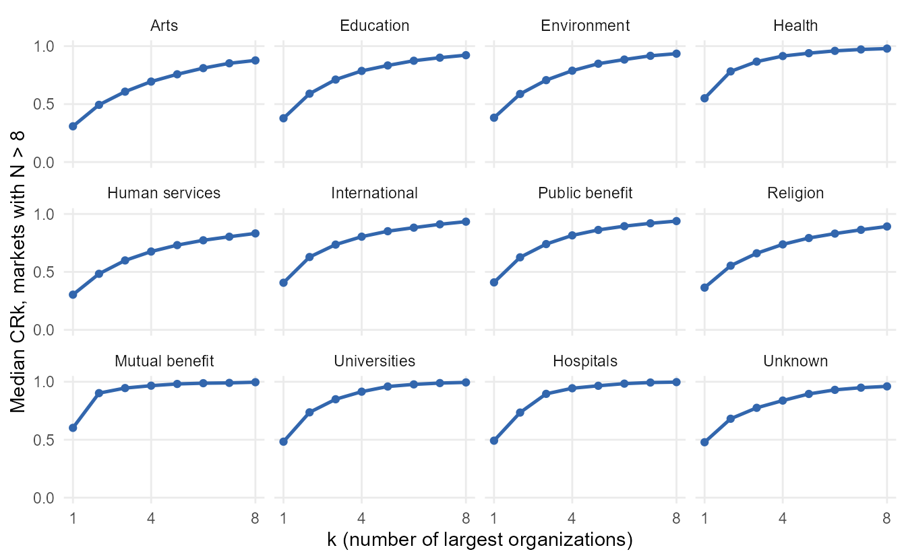
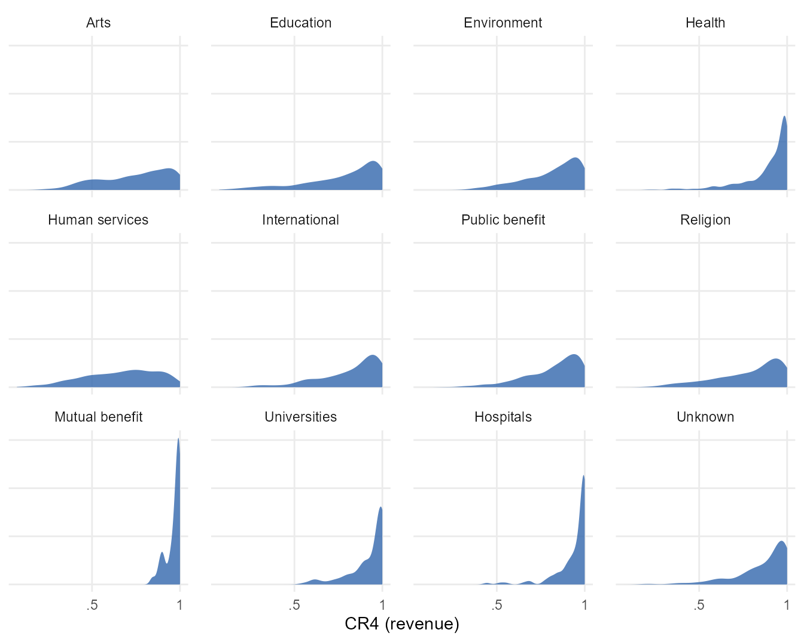
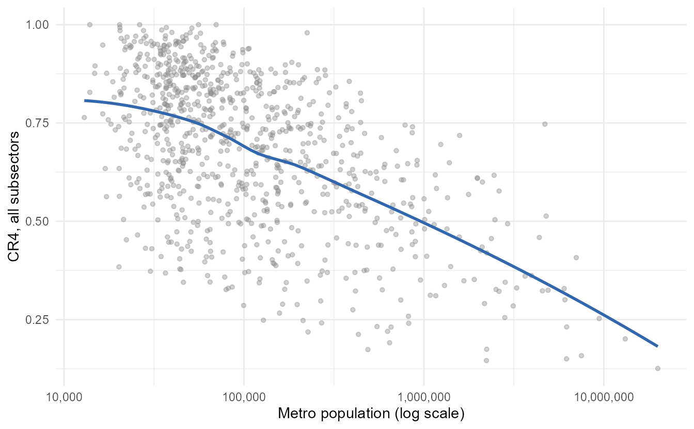
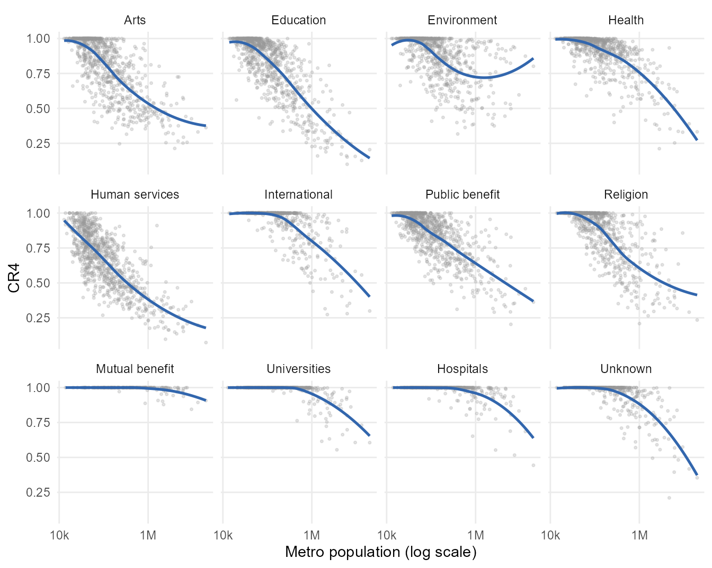
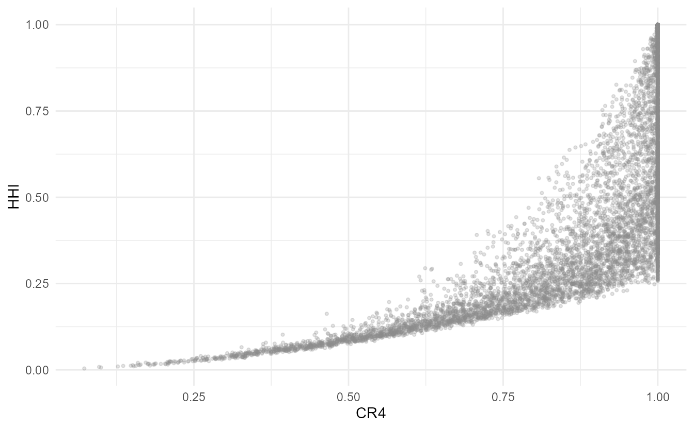

# Concentration ratios

A concentration ratio is the share of a market held by its largest
organizations. CR4 is the share held by the four largest:

``` math
CR_k = \sum_{i=1}^{k} s_{(i)}
```

where $`s_{(1)} \ge s_{(2)} \ge \dots`$ are market shares sorted from
largest to smallest. Concentration ratios are easy to explain (“the four
largest arts organizations take in 80% of arts revenue”) but ignore how
the share is split among the top $`k`$ and everything below them. A
market with $`k`$ or fewer organizations has $`CR_k = 1`$.

[`get_cr()`](https://nonprofit-open-data-collective.github.io/npcompete/reference/get_cr.md)
returns one ratio and
[`get_cr_all()`](https://nonprofit-open-data-collective.github.io/npcompete/reference/get_cr_all.md)
returns several at once (CR1 to CR8 by default).

``` r

library( npcompete )
library( ggplot2 )
#> Warning: package 'ggplot2' was built under R version 4.4.3

# NTMAJ12 labels for the NTEEV2 major groups
ntmaj12 <- c( ART = "Arts",           EDU = "Education",
              ENV = "Environment",    HEL = "Health",
              HMS = "Human services", IFA = "International",
              PSB = "Public benefit", REL = "Religion",
              MMB = "Mutual benefit", UNI = "Universities",
              HOS = "Hospitals",      UNU = "Unknown" )
```

## A toy market

``` r

TOTREV <- c( 50, 30, 10, 5, 5 )
toy    <- data.frame( GEO = "A", SUB = "ART", YEAR = 2020, TOTREV )

cr <- get_cr_all( toy, geography = "GEO", subsector = "SUB",
                  year = "YEAR", numbers = 1:5 )
subset( cr, GEO == "A" & SUB == "ART" ) |> knitr::kable( digits = 2 )
```

| GEO | SUB | YEAR |   N | TOTREV | CR1 | CR2 | CR3 |  CR4 | CR5 |
|:----|:----|-----:|----:|-------:|----:|----:|----:|-----:|----:|
| A   | ART | 2020 |   5 |    100 | 0.5 | 0.8 | 0.9 | 0.95 |   1 |

Pass `as_percent = TRUE` for a 0-100 scale.

## Computing concentration ratios from org-level data

`npo_panel_sample` holds every 501(c)(3) filer in Vermont from 2015 to
2019, one row per organization-year. Here the market is the county.

``` r

vt <- get_cr_all( npo_panel_sample, geography = "COUNTY_FIPS",
                  numbers = c( 1, 4, 8 ) )

# all subsectors combined, one row per county
vt19 <- subset( vt, YEAR == 2019 & SUB == "ALL" & GEO != "ALL" )
vt19[ order( vt19$CR4 ), ] |> knitr::kable( digits = 2, row.names = FALSE )
```

| GEO   | SUB | YEAR |   N |     TOTREV |  CR1 |  CR4 |  CR8 |
|:------|:----|-----:|----:|-----------:|-----:|-----:|-----:|
| 50027 | ALL | 2019 | 209 |  531664166 | 0.19 | 0.48 | 0.69 |
| 50023 | ALL | 2019 | 251 |  892948016 | 0.27 | 0.62 | 0.72 |
| 50025 | ALL | 2019 | 181 |  493992132 | 0.22 | 0.64 | 0.77 |
| 50007 | ALL | 2019 | 414 | 3104992885 | 0.50 | 0.67 | 0.76 |
| 50013 | ALL | 2019 |  15 |    5953848 | 0.22 | 0.70 | 0.88 |
| 50003 | ALL | 2019 | 124 |  407276766 | 0.43 | 0.71 | 0.81 |
| 50015 | ALL | 2019 |  83 |  164242466 | 0.45 | 0.72 | 0.87 |
| 50017 | ALL | 2019 |  73 |  134978038 | 0.44 | 0.73 | 0.89 |
| 50005 | ALL | 2019 |  82 |  213517887 | 0.44 | 0.79 | 0.87 |
| 50019 | ALL | 2019 |  54 |  193858577 | 0.52 | 0.83 | 0.91 |
| 50001 | ALL | 2019 | 123 |  655600800 | 0.61 | 0.83 | 0.89 |
| 50009 | ALL | 2019 |   7 |     660374 | 0.36 | 0.85 | 1.00 |
| 50021 | ALL | 2019 | 117 |  465598138 | 0.64 | 0.85 | 0.90 |
| 50011 | ALL | 2019 |  53 |  214552885 | 0.55 | 0.90 | 0.96 |

## Concentration ratios across US metro areas

`cbsa_metrics` holds every metric for every US metro and micro area
(CBSA) in 2019, by NTEE major group, measured on total revenue.

``` r

metros <- cbsa_metrics
metros$NTMAJ12 <- factor( ntmaj12[ metros$SUB ], levels = ntmaj12 )

# subsector markets with at least one organization and some revenue
# (HHI is NA where total revenue is zero, which leaves shares undefined)
markets <- subset( metros, SUB != "ALL" & N > 0 & !is.na( HHI ) )
```

### Descriptive statistics by subsector

``` r

markets |>
  dplyr::group_by( NTMAJ12 ) |>
  dplyr::summarize(
    metros     = dplyr::n(),
    median_N   = median( N ),
    CR1_median = median( CR1 ),
    CR4_p25    = quantile( CR4, 0.25 ),
    CR4_median = median( CR4 ),
    CR4_p75    = quantile( CR4, 0.75 ),
    N_le_4     = mean( N <= 4 )
  ) |>
  knitr::kable( digits = 2 )
```

| NTMAJ12        | metros | median_N | CR1_median | CR4_p25 | CR4_median | CR4_p75 | N_le_4 |
|:---------------|-------:|---------:|-----------:|--------:|-----------:|--------:|-------:|
| Arts           |    894 |        9 |       0.45 |    0.68 |       0.88 |    1.00 |   0.26 |
| Education      |    916 |       12 |       0.49 |    0.72 |       0.91 |    0.99 |   0.19 |
| Environment    |    872 |        6 |       0.57 |    0.83 |       0.98 |    1.00 |   0.42 |
| Health         |    912 |        9 |       0.68 |    0.90 |       0.98 |    1.00 |   0.25 |
| Human services |    936 |       36 |       0.32 |    0.52 |       0.70 |    0.85 |   0.02 |
| International  |    567 |        3 |       0.77 |    0.94 |       1.00 |    1.00 |   0.63 |
| Public benefit |    919 |       11 |       0.51 |    0.77 |       0.90 |    0.99 |   0.19 |
| Religion       |    865 |        6 |       0.57 |    0.81 |       0.98 |    1.00 |   0.43 |
| Mutual benefit |    259 |        1 |       1.00 |    1.00 |       1.00 |    1.00 |   0.85 |
| Universities   |    489 |        2 |       0.99 |    1.00 |       1.00 |    1.00 |   0.77 |
| Hospitals      |    538 |        2 |       0.98 |    1.00 |       1.00 |    1.00 |   0.76 |
| Unknown        |    555 |        2 |       0.88 |    0.98 |       1.00 |    1.00 |   0.69 |

`N_le_4` is the share of metros where the subsector has four or fewer
organizations, so CR4 is 1 by definition. In most subsectors the median
CR4 is already well above one half: a handful of organizations holds
most of the revenue even where there are dozens of organizations.

### The concentration curve

Plotting $`CR_k`$ against $`k`$ shows how fast the top organizations
account for the market. The lines are medians across metros, for markets
with more than eight organizations so that no ratio is capped at 1.

``` r

big <- subset( markets, N > 8 )

cr_cols <- paste0( "CR", 1:8 )
curve   <- aggregate( big[ cr_cols ], by = list( NTMAJ12 = big$NTMAJ12 ),
                      FUN = median )
curve   <- tidyr::pivot_longer( curve, -NTMAJ12, names_to = "k",
                                values_to = "CR" )
curve$k <- as.integer( sub( "CR", "", curve$k ) )

ggplot( curve, aes( k, CR ) ) +
  geom_line( colour = "#3266ad", linewidth = 0.9 ) +
  geom_point( colour = "#3266ad", size = 1.5 ) +
  facet_wrap( ~ NTMAJ12, ncol = 4 ) +
  scale_x_continuous( breaks = c( 1, 4, 8 ) ) +
  scale_y_continuous( limits = c( 0, 1 ), breaks = c( 0, 0.5, 1 ) ) +
  labs( x = "k (number of largest organizations)",
        y = "Median CRk, markets with N > 8" ) +
  theme_minimal() +
  theme( panel.grid.minor = element_blank() )
```



### Distribution of CR4 by subsector

Markets with four or fewer organizations are left out; they are a spike
at 1.

``` r

ggplot( subset( markets, N > 4 ), aes( CR4 ) ) +
  geom_density( fill = "#3266ad", colour = NA, alpha = 0.8 ) +
  facet_wrap( ~ NTMAJ12, ncol = 4 ) +
  scale_x_continuous( breaks = c( 0, 0.5, 1 ), labels = c( "0", ".5", "1" ) ) +
  labs( x = "CR4 (revenue)", y = NULL ) +
  theme_minimal() +
  theme( axis.text.y      = element_blank(),
         panel.grid.minor = element_blank(),
         panel.spacing.x  = unit( 1, "lines" ) )
```



### CR4 and metro size

All subsectors combined, one point per metro, with a loess smooth:

``` r

all_subs <- subset( metros, SUB == "ALL" & !is.na( POP ) )

ggplot( all_subs, aes( POP, CR4 ) ) +
  geom_point( colour = "grey55", alpha = 0.4, size = 1.2 ) +
  geom_smooth( method = "loess", formula = y ~ x, se = FALSE,
               colour = "#3266ad", linewidth = 1 ) +
  scale_x_log10( labels = scales::label_comma() ) +
  labs( x = "Metro population (log scale)", y = "CR4, all subsectors" ) +
  theme_minimal()
```



By subsector:

``` r

ggplot( subset( markets, !is.na( POP ) ), aes( POP, CR4 ) ) +
  geom_point( colour = "grey60", alpha = 0.25, size = 0.6 ) +
  geom_smooth( method = "loess", formula = y ~ x, se = FALSE,
               colour = "#3266ad", linewidth = 0.9 ) +
  facet_wrap( ~ NTMAJ12, ncol = 4 ) +
  scale_x_log10( breaks = c( 1e4, 1e6 ), labels = c( "10k", "1M" ) ) +
  labs( x = "Metro population (log scale)", y = "CR4" ) +
  theme_minimal() +
  theme( panel.grid.minor = element_blank() )
```



### CR4 versus HHI

The two measures largely agree, but CR4 saturates at 1 in small markets
while HHI keeps separating them:

``` r

ggplot( markets, aes( CR4, HHI ) ) +
  geom_point( colour = "grey55", alpha = 0.25, size = 0.8 ) +
  labs( x = "CR4", y = "HHI" ) +
  theme_minimal()
```



## Notes

- Pick $`k`$ to fit the market. CR4 is the convention in industrial
  organization, but in nonprofit subsectors with a median of a few
  organizations per metro, CR1 or CR2 carries more information.
- Because $`CR_k = 1`$ whenever $`N \le k`$, compare concentration
  ratios only among markets with more than $`k`$ organizations.
