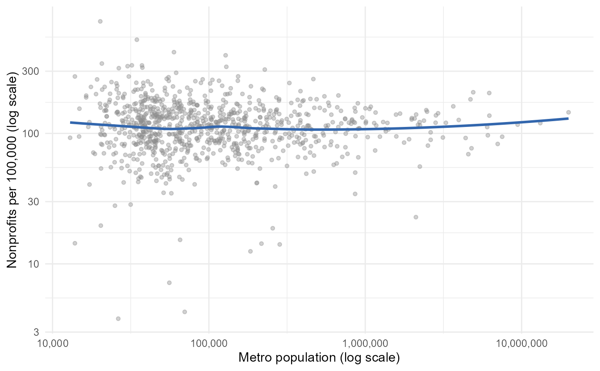
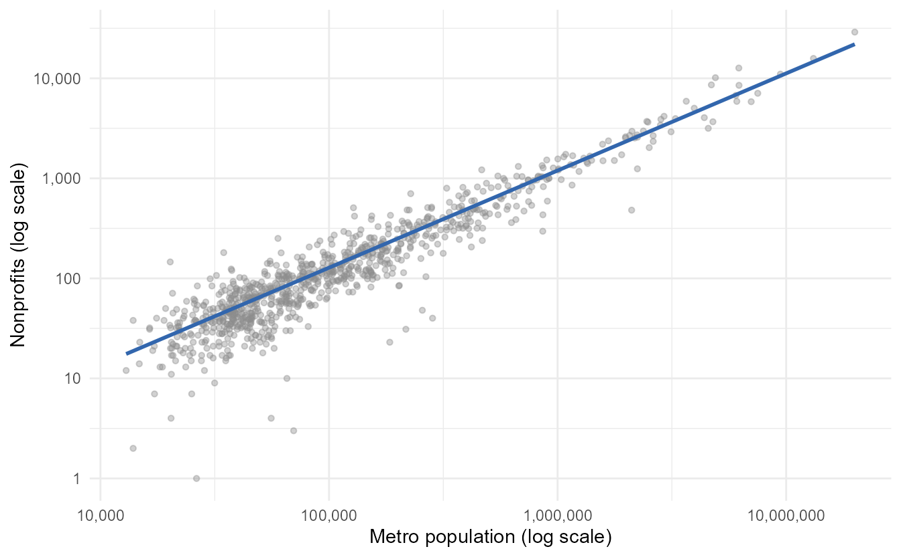
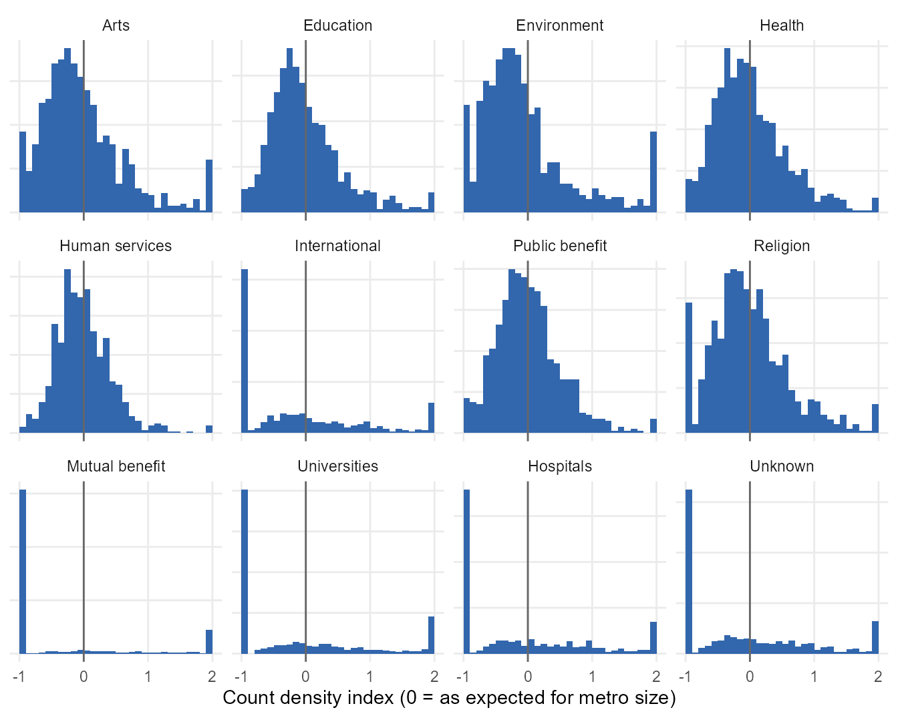
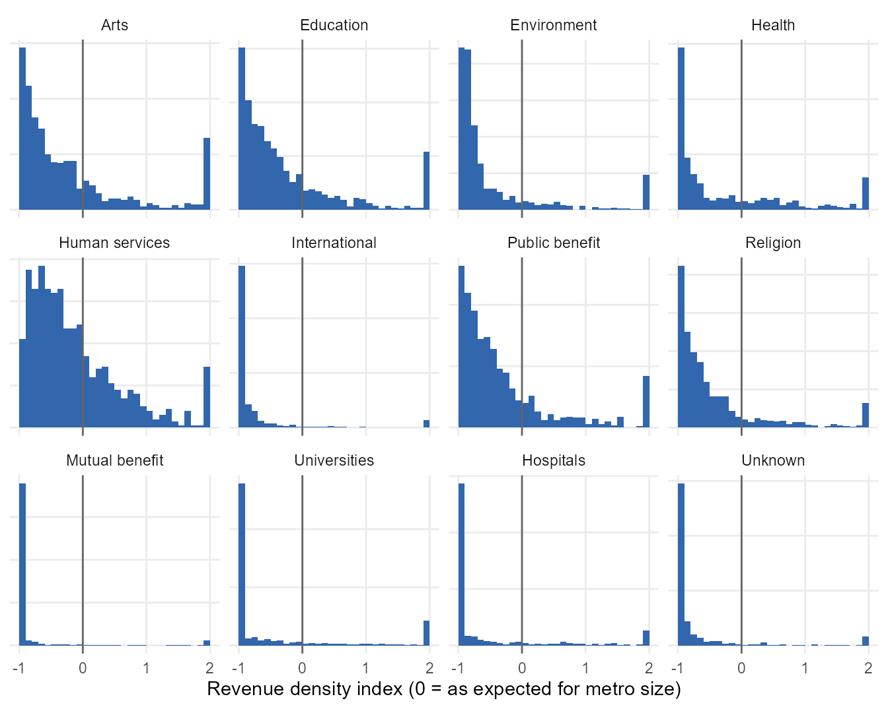
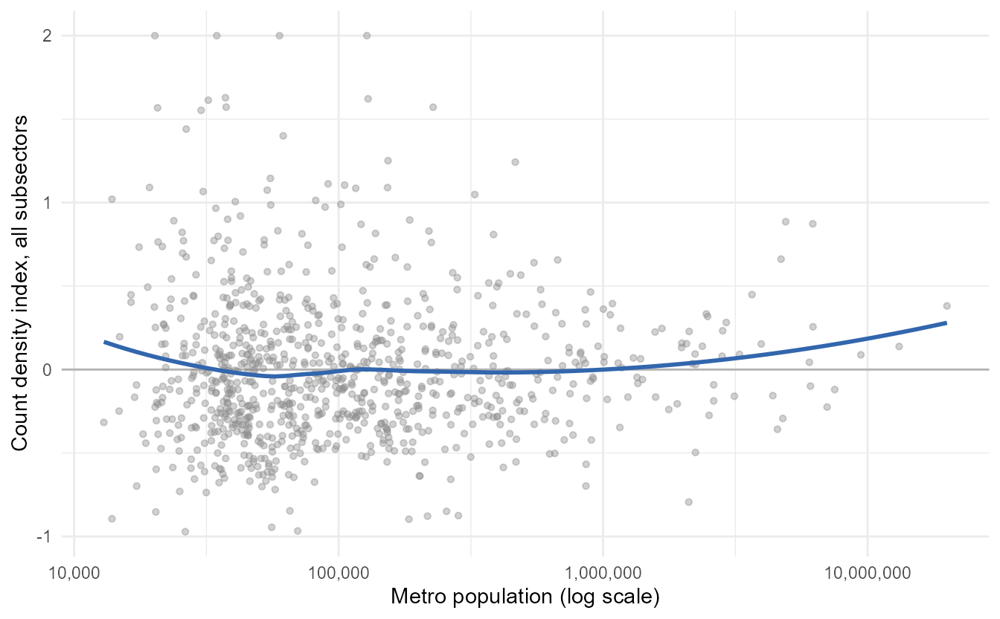
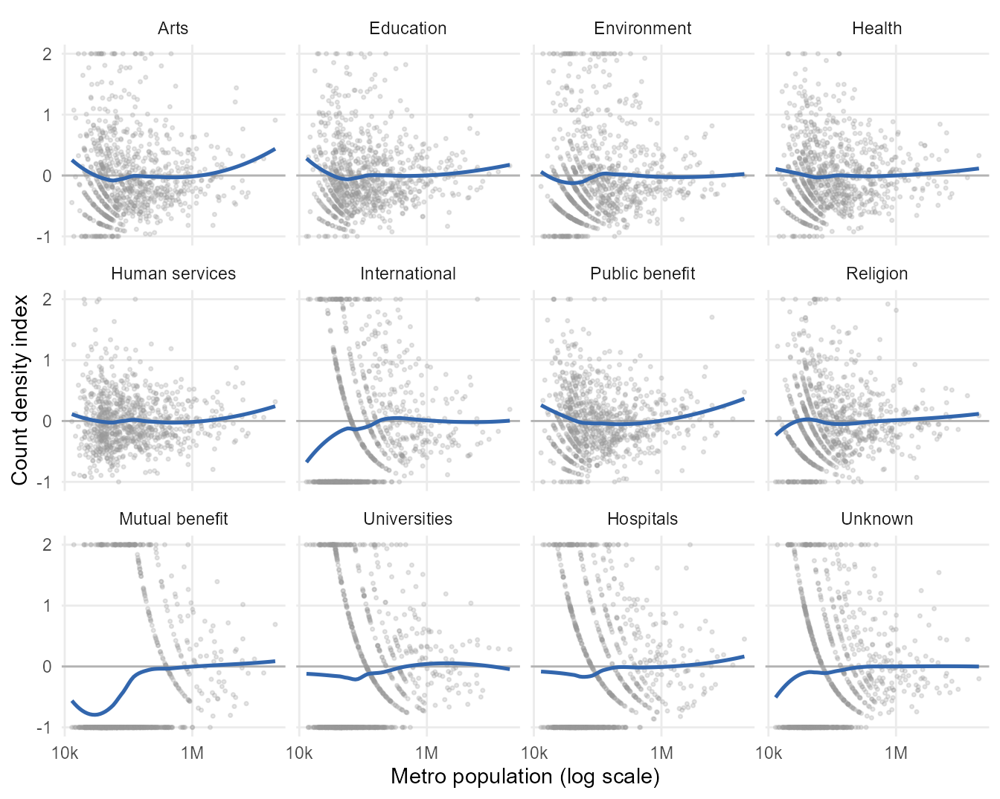
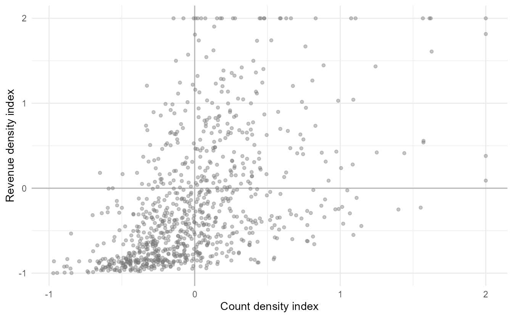

# Scale-free nonprofit density

Density asks whether a market has more or fewer nonprofits than you
would expect. The usual measure, nonprofits per 100,000 residents,
assumes the number of organizations, and their revenue, grows in
proportion to population. For counts that is roughly true across US
metros, though not in every subsector. For revenue it is not: nonprofit
revenue grows faster than population, so per-capita revenue mostly
measures how large a place is.

[`get_scale_free_density()`](https://nonprofit-open-data-collective.github.io/npcompete/reference/get_scale_free_density.md)
fits the relationship between population and the number of nonprofits
(and their revenue) across markets, within each subsector and year, and
compares each market with the value expected for its size:

``` math
DENSITY\_PCTL = \frac{observed}{expected} - 1
```

0 means a market has exactly the expected number for its size, 0.5 means
50% more, and -1 means none at all. Values are capped at 2. The count
model is a negative binomial regression of $`N`$ on $`\log(POP)`$ by
default; the revenue model is a quasi-Poisson regression of total
revenue on $`\log(POP)`$. Both imply a power law,
$`expected = a \cdot POP^{\,b}`$.

``` r
library( npcompete )
library( ggplot2 )

# NTMAJ12 labels for the NTEEV2 major groups
ntmaj12 <- c( ART = "Arts",           EDU = "Education",
              ENV = "Environment",    HEL = "Health",
              HMS = "Human services", IFA = "International",
              PSB = "Public benefit", REL = "Religion",
              MMB = "Mutual benefit", UNI = "Universities",
              HOS = "Hospitals",      UNU = "Unknown" )
```

## Computing density from org-level data

`npo_panel_sample` holds every 501(c)(3) filer in Vermont from 2015 to
2019, one row per organization-year, with county and metro populations
merged on. Here the market is the county.

``` r
# with only 14 counties, a few thin subsector models do not converge
d <- get_scale_free_density( npo_panel_sample,
                             geography  = "COUNTY_FIPS",
                             population = "POP_COUNTY" )

vars <- c( "GEO", "POP", "N", "EXPECTED_N", "DENSITY_PCTL_N", "DENSITY_PCTL_R" )
vt19 <- subset( d, YEAR == 2019 & SUB == "ALL" & GEO != "ALL", vars )
vt19[ order( vt19$DENSITY_PCTL_N ), ] |> knitr::kable( digits = 2, row.names = FALSE )
```

| GEO   |      POP |   N | EXPECTED_N | DENSITY_PCTL_N | DENSITY_PCTL_R |
|:------|---------:|----:|-----------:|---------------:|---------------:|
| 50011 |  49726.0 |  54 |     146.87 |          -0.63 |          -0.56 |
| 50021 |  60679.0 | 125 |     184.14 |          -0.32 |          -0.30 |
| 50007 | 167145.2 | 424 |     582.21 |          -0.27 |           0.00 |
| 50009 |   5958.6 |  10 |      13.19 |          -0.24 |          -0.97 |
| 50019 |  27376.8 |  57 |      74.55 |          -0.24 |          -0.02 |
| 50013 |   7260.7 |  15 |      16.51 |          -0.09 |          -0.77 |
| 50017 |  29242.9 |  78 |      80.35 |          -0.03 |          -0.38 |
| 50005 |  30332.4 |  87 |      83.76 |           0.04 |          -0.08 |
| 50001 |  37308.8 | 126 |     105.97 |           0.19 |           1.07 |
| 50015 |  25798.0 |  83 |      69.69 |           0.19 |          -0.09 |
| 50003 |  37324.8 | 129 |     106.02 |           0.22 |           0.28 |
| 50027 |  57644.7 | 214 |     173.72 |           0.23 |          -0.14 |
| 50023 |  59779.7 | 258 |     181.04 |           0.43 |           0.37 |
| 50025 |  45765.8 | 191 |     133.66 |           0.43 |           0.14 |

Every market in the population frame appears in every subsector, with
`N = 0` where it has no organizations, so the models are not limited to
markets that happen to have one. The fitted models are kept in the list
columns `model_n` and `model_r`; the slope on log population is the
scaling exponent $`b`$:

``` r
m_all <- subset( d, YEAR == 2019 & SUB == "ALL" & GEO != "ALL" )$model_n[[ 1 ]]
coef( m_all )
#> (Intercept)     LOG_POP 
#>   -7.296217    1.136067
```

Fourteen counties is a thin base for a model; the rest of this page uses
every US metro.

## Density across US metro areas

`cbsa_metrics` holds every metric for every US metro and micro area
(CBSA) in 2019, by NTEE major group, measured on total revenue,
including the expected values from the density models.

``` r
metros <- cbsa_metrics
metros$NTMAJ12 <- factor( ntmaj12[ metros$SUB ], levels = ntmaj12 )
metros <- subset( metros, !is.na( POP ) )

all_subs <- subset( metros, SUB == "ALL" )
markets  <- subset( metros, SUB != "ALL" )
```

### Why per-capita density misleads

Across all subsectors, nonprofits per 100,000 residents are roughly flat
across metro size, with much more scatter among small metros:

``` r
all_subs$PER_100K <- 1e5 * all_subs$N / all_subs$POP

ggplot( all_subs, aes( POP, PER_100K ) ) +
  geom_point( colour = "grey55", alpha = 0.4, size = 1.2 ) +
  geom_smooth( method = "loess", formula = y ~ x, se = FALSE,
               colour = "#3266ad", linewidth = 1 ) +
  scale_x_log10( labels = scales::label_comma() ) +
  scale_y_log10() +
  labs( x = "Metro population (log scale)",
        y = "Nonprofits per 100,000 (log scale)" ) +
  theme_minimal()
```



On log-log axes the count itself is close to a straight line. The fitted
power law (blue) is the expected count; the density index is each
metro’s distance from it.

``` r
all_subs <- all_subs[ order( all_subs$POP ), ]

ggplot( all_subs, aes( POP, N ) ) +
  geom_point( colour = "grey55", alpha = 0.4, size = 1.2 ) +
  geom_line( aes( y = EXPECTED_N ), colour = "#3266ad", linewidth = 1 ) +
  scale_x_log10( labels = scales::label_comma() ) +
  scale_y_log10( labels = scales::label_comma() ) +
  labs( x = "Metro population (log scale)",
        y = "Nonprofits (log scale)" ) +
  theme_minimal()
```



The slope of that line is the scaling exponent $`b`$. At 1, a metro ten
times larger has ten times as many nonprofits and per-capita density
works fine. Below 1, larger metros have fewer per resident; above 1,
more. The exponents by subsector, for counts and for revenue:

``` r
# slope of log expected value on log population, by subsector
exponent <- function( d, y ) {
  ok <- d[[ y ]] > 0 & !is.na( d[[ y ]] )
  unname( coef( lm( log( d[[ y ]][ ok ] ) ~ log( d$POP[ ok ] ) ) )[ 2 ] )
}

by_sub <- split( metros, metros$SUB )

data.frame( subsector = c( ALL = "All", ntmaj12 )[ names( by_sub ) ],
            count     = sapply( by_sub, exponent, y = "EXPECTED_N" ),
            revenue   = sapply( by_sub, exponent, y = "EXPECTED_TOTREV" ) ) |>
  knitr::kable( digits = 2, row.names = FALSE )
```

| subsector      | count | revenue |
|:---------------|------:|--------:|
| All            |  0.97 |    1.16 |
| Arts           |  0.97 |    1.32 |
| Education      |  1.04 |    1.18 |
| Environment    |  0.92 |    1.36 |
| Health         |  0.98 |    1.09 |
| Human services |  0.94 |    1.13 |
| Hospitals      |  0.88 |    1.17 |
| International  |  1.22 |    1.36 |
| Mutual benefit |  1.00 |    1.55 |
| Public benefit |  0.97 |    1.28 |
| Religion       |  1.05 |    1.19 |
| Universities   |  0.96 |    1.21 |
| Unknown        |  1.05 |    1.16 |

Count exponents sit near 1, from below 0.9 for hospitals to above 1.2
for international organizations. Revenue exponents are all above 1, most
of them well above: a metro ten times larger has many more than ten
times the nonprofit revenue, because the largest hospitals, universities
and national organizations sit in large metros. Revenue per capita would
rank nearly every large metro as “dense”. The density index removes that
size effect.

### Descriptive statistics by subsector

``` r
markets |>
  dplyr::group_by( NTMAJ12 ) |>
  dplyr::summarize(
    metros    = dplyr::n(),
    none      = mean( N == 0 ),
    N_p25     = quantile( DENSITY_PCTL_N, 0.25, na.rm = TRUE ),
    N_median  = median( DENSITY_PCTL_N, na.rm = TRUE ),
    N_p75     = quantile( DENSITY_PCTL_N, 0.75, na.rm = TRUE ),
    R_median  = median( DENSITY_PCTL_R, na.rm = TRUE ),
    R_capped  = mean( DENSITY_PCTL_R == 2, na.rm = TRUE )
  ) |>
  knitr::kable( digits = 2 )
```

| NTMAJ12        | metros | none | N_p25 | N_median | N_p75 | R_median | R_capped |
|:---------------|-------:|-----:|------:|---------:|------:|---------:|---------:|
| Arts           |    881 | 0.04 | -0.46 |    -0.14 |  0.27 |    -0.55 |     0.07 |
| Education      |    881 | 0.01 | -0.38 |    -0.12 |  0.25 |    -0.56 |     0.06 |
| Environment    |    881 | 0.06 | -0.52 |    -0.22 |  0.16 |    -0.80 |     0.05 |
| Health         |    881 | 0.02 | -0.39 |    -0.08 |  0.30 |    -0.72 |     0.06 |
| Human services |    881 | 0.00 | -0.28 |    -0.05 |  0.24 |    -0.33 |     0.03 |
| International  |    881 | 0.37 | -1.00 |    -0.34 |  0.44 |    -0.97 |     0.03 |
| Public benefit |    881 | 0.02 | -0.33 |    -0.05 |  0.27 |    -0.56 |     0.04 |
| Religion       |    881 | 0.07 | -0.39 |    -0.08 |  0.29 |    -0.69 |     0.03 |
| Mutual benefit |    881 | 0.71 | -1.00 |    -1.00 | -0.11 |    -1.00 |     0.03 |
| Universities   |    881 | 0.46 | -1.00 |    -0.49 |  0.52 |    -1.00 |     0.09 |
| Hospitals      |    881 | 0.41 | -1.00 |    -0.36 |  0.63 |    -1.00 |     0.06 |
| Unknown        |    881 | 0.38 | -1.00 |    -0.30 |  0.57 |    -0.98 |     0.04 |

`none` is the share of metros with no organization in the subsector
(density -1). The count index has a median a little below 0, since
counts are right-skewed and the model fits their mean. The revenue index
has a median well below 0 and a share capped at 2 (`R_capped`): revenue
is so skewed that most metros fall short of the fitted mean while a few,
home to a large hospital or university, exceed it many times over.

### Distribution by subsector

Count density (`DENSITY_PCTL_N`):

``` r
ggplot( markets, aes( DENSITY_PCTL_N ) ) +
  geom_histogram( binwidth = 0.1, boundary = 0, fill = "#3266ad" ) +
  geom_vline( xintercept = 0, colour = "grey40" ) +
  facet_wrap( ~ NTMAJ12, ncol = 4, scales = "free_y" ) +
  labs( x = "Count density index (0 = as expected for metro size)",
        y = NULL ) +
  theme_minimal() +
  theme( axis.text.y      = element_blank(),
         panel.grid.minor = element_blank() )
```



The bar at -1 is metros with no organization in the subsector; the bar
at 2 is the cap. Thin subsectors (international, mutual benefit,
universities, hospitals) pile up at both ends.

Revenue density (`DENSITY_PCTL_R`):

``` r
ggplot( markets, aes( DENSITY_PCTL_R ) ) +
  geom_histogram( binwidth = 0.1, boundary = 0, fill = "#3266ad" ) +
  geom_vline( xintercept = 0, colour = "grey40" ) +
  facet_wrap( ~ NTMAJ12, ncol = 4, scales = "free_y" ) +
  labs( x = "Revenue density index (0 = as expected for metro size)",
        y = NULL ) +
  theme_minimal() +
  theme( axis.text.y      = element_blank(),
         panel.grid.minor = element_blank() )
```



### Density and metro size

If the model fits, the index should be flat across metro size: that is
what “scale-free” means. All subsectors combined:

``` r
ggplot( all_subs, aes( POP, DENSITY_PCTL_N ) ) +
  geom_hline( yintercept = 0, colour = "grey70" ) +
  geom_point( colour = "grey55", alpha = 0.4, size = 1.2 ) +
  geom_smooth( method = "loess", formula = y ~ x, se = FALSE,
               colour = "#3266ad", linewidth = 1 ) +
  scale_x_log10( labels = scales::label_comma() ) +
  labs( x = "Metro population (log scale)",
        y = "Count density index, all subsectors" ) +
  theme_minimal()
```



The smooth stays close to 0 over most of the range, rising slightly
among the very largest metros. The spread narrows in larger metros,
where counts are large and less noisy. By subsector:

``` r
ggplot( markets, aes( POP, DENSITY_PCTL_N ) ) +
  geom_hline( yintercept = 0, colour = "grey70" ) +
  geom_point( colour = "grey60", alpha = 0.25, size = 0.6 ) +
  geom_smooth( method = "loess", formula = y ~ x, se = FALSE,
               colour = "#3266ad", linewidth = 0.9 ) +
  facet_wrap( ~ NTMAJ12, ncol = 4 ) +
  scale_x_log10( breaks = c( 1e4, 1e6 ), labels = c( "10k", "1M" ) ) +
  labs( x = "Metro population (log scale)", y = "Count density index" ) +
  theme_minimal() +
  theme( panel.grid.minor = element_blank() )
```



### Count density versus revenue density

A metro can have many organizations but little revenue (lots of small
groups) or few organizations with a lot of revenue (a dominant
institution).

``` r
ggplot( all_subs, aes( DENSITY_PCTL_N, DENSITY_PCTL_R ) ) +
  geom_hline( yintercept = 0, colour = "grey70" ) +
  geom_vline( xintercept = 0, colour = "grey70" ) +
  geom_point( colour = "grey45", alpha = 0.4, size = 1.2 ) +
  labs( x = "Count density index", y = "Revenue density index" ) +
  theme_minimal()
```



## Notes

- `model = "poisson"` and `model = "loglinear"` are available. The
  log-linear model regresses $`\log(N + 1)`$ on $`\log(POP + 1)`$ and
  computes the index from the residual, which compresses differences
  among small markets.
- Supply `pop_table` (columns `GEO`, `YEAR`, `POP`) so that markets with
  no organizations at all are part of the frame. Without it, only
  markets with at least one organization in some subsector appear.
- Rows with `GEO = "ALL"` are national totals and have no density index.
- The legacy functions
  [`get_density()`](https://nonprofit-open-data-collective.github.io/npcompete/reference/get_density.md),
  [`get_density_small()`](https://nonprofit-open-data-collective.github.io/npcompete/reference/get_density_small.md),
  [`get_density_big()`](https://nonprofit-open-data-collective.github.io/npcompete/reference/get_density_big.md)
  and
  [`get_density_commercial()`](https://nonprofit-open-data-collective.github.io/npcompete/reference/get_density_commercial.md)
  use the old NCCS core file layout and are deprecated.
