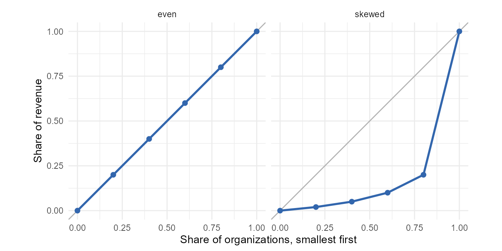
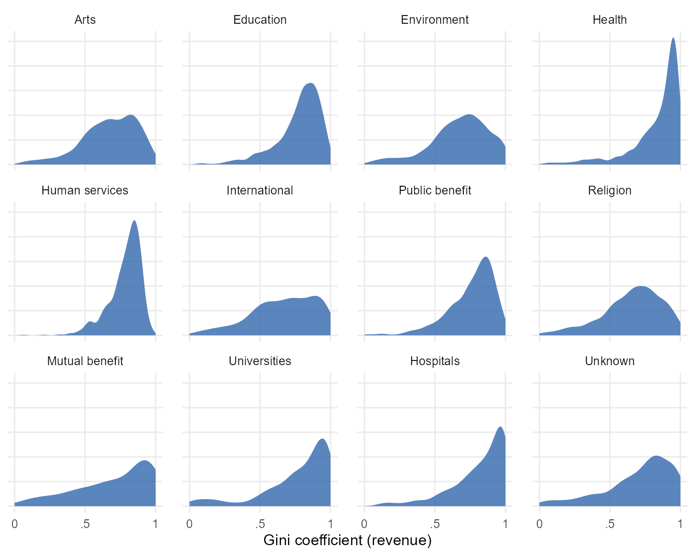
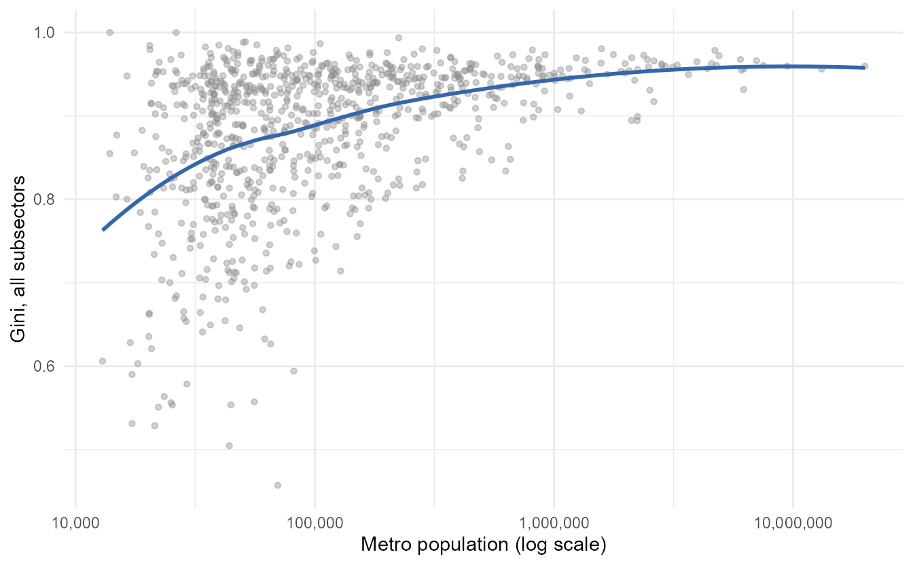
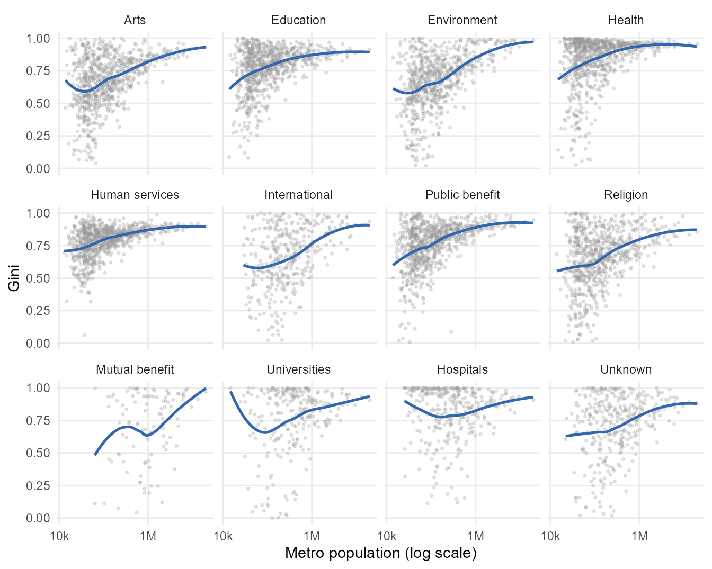
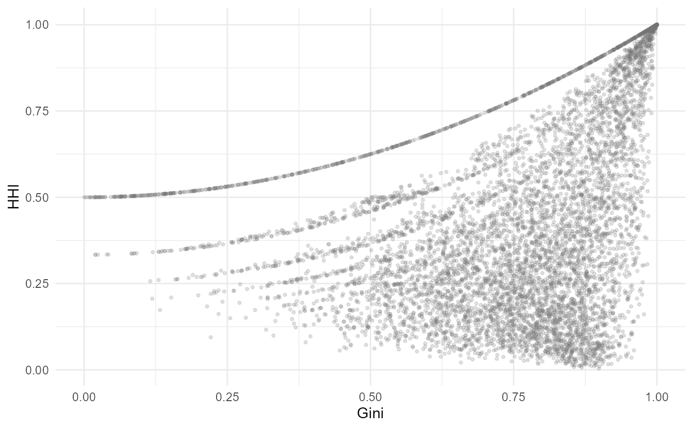

# Gini coefficient

The Gini coefficient measures inequality: how unevenly a resource is
spread across the organizations in a market. It is twice the area
between the Lorenz curve (the cumulative share of the resource held by
the smallest $`p`$ percent of organizations) and the line of perfect
equality. It is 0 when every organization is the same size and
approaches 1 when one organization holds everything.

Inequality is not the same thing as concentration. Two equal
organizations have a Gini of 0 but an HHI of 0.5; a market of 500
organizations with a few large ones can have a high Gini and a low HHI.
Seaman et al. (2014) read values below 0.5 as reasonable equality, 0.5
to 0.75 as modest inequality and above 0.75 as high inequality.

[`get_gini()`](https://nonprofit-open-data-collective.github.io/npcompete/reference/get_gini.md)
computes it with
[`DescTools::Gini()`](https://andrisignorell.github.io/DescTools/reference/Gini.html).

``` r

library( npcompete )
library( ggplot2 )
#> Warning: package 'ggplot2' was built under R version 4.4.3

# NTMAJ12 labels for the NTEEV2 major groups
ntmaj12 <- c( ART = "Arts",           EDU = "Education",
              ENV = "Environment",    HEL = "Health",
              HMS = "Human services", IFA = "International",
              PSB = "Public benefit", REL = "Religion",
              MMB = "Mutual benefit", UNI = "Universities",
              HOS = "Hospitals",      UNU = "Unknown" )
```

## A toy market

``` r

GEO    <- rep( c( "even", "skewed" ), each = 5 )
TOTREV <- c( 20, 20, 20, 20, 20,   2, 3, 5, 10, 80 )

toy <- data.frame( GEO, SUB = "ART", YEAR = 2020, TOTREV )

g <- get_gini( toy, geography = "GEO", subsector = "SUB", year = "YEAR" )
subset( g, GEO != "ALL" & SUB != "ALL" ) |> knitr::kable( digits = 2 )
```

| GEO    | SUB | YEAR |   N | TOTREV | GINI |
|:-------|:----|-----:|----:|-------:|-----:|
| even   | ART | 2020 |   5 |    100 | 0.00 |
| skewed | ART | 2020 |   5 |    100 | 0.82 |

The Lorenz curves behind those numbers:

``` r

lorenz <- function( x ) {
  x <- sort( x )
  data.frame( p = c( 0, seq_along( x ) / length( x ) ),
              L = c( 0, cumsum( x ) / sum( x ) ) )
}

curves <- rbind( cbind( GEO = "even",   lorenz( TOTREV[ GEO == "even" ] ) ),
                 cbind( GEO = "skewed", lorenz( TOTREV[ GEO == "skewed" ] ) ) )

ggplot( curves, aes( p, L ) ) +
  geom_abline( colour = "grey70" ) +
  geom_line( colour = "#3266ad", linewidth = 1 ) +
  geom_point( colour = "#3266ad", size = 2 ) +
  facet_wrap( ~ GEO ) +
  coord_equal() +
  labs( x = "Share of organizations, smallest first",
        y = "Share of revenue" ) +
  theme_minimal()
```



## Computing the Gini from org-level data

`npo_panel_sample` holds every 501(c)(3) filer in Vermont from 2015 to
2019, one row per organization-year. Here the market is the county.

``` r

vt <- get_gini( npo_panel_sample, geography = "COUNTY_FIPS" )

# all subsectors combined, one row per county
vt19 <- subset( vt, YEAR == 2019 & SUB == "ALL" & GEO != "ALL" )
vt19[ order( vt19$GINI ), ] |> knitr::kable( digits = 3, row.names = FALSE )
```

| GEO   | SUB | YEAR |   N |     TOTREV |  GINI |
|:------|:----|-----:|----:|-----------:|------:|
| 50009 | ALL | 2019 |   7 |     660374 | 0.482 |
| 50013 | ALL | 2019 |  15 |    5953848 | 0.569 |
| 50027 | ALL | 2019 | 209 |  531664166 | 0.886 |
| 50025 | ALL | 2019 | 181 |  493992132 | 0.899 |
| 50015 | ALL | 2019 |  83 |  164242466 | 0.899 |
| 50017 | ALL | 2019 |  73 |  134978038 | 0.900 |
| 50023 | ALL | 2019 | 251 |  892948016 | 0.903 |
| 50003 | ALL | 2019 | 124 |  407276766 | 0.903 |
| 50005 | ALL | 2019 |  82 |  213517887 | 0.910 |
| 50019 | ALL | 2019 |  54 |  193858577 | 0.911 |
| 50011 | ALL | 2019 |  53 |  214552885 | 0.941 |
| 50007 | ALL | 2019 | 414 | 3104992885 | 0.942 |
| 50001 | ALL | 2019 | 123 |  655600800 | 0.946 |
| 50021 | ALL | 2019 | 117 |  465598138 | 0.947 |

Set `year = NULL` to pool all years.

## The Gini across US metro areas

`cbsa_metrics` holds every metric for every US metro and micro area
(CBSA) in 2019, by NTEE major group, measured on total revenue.

``` r

metros <- cbsa_metrics
metros$NTMAJ12 <- factor( ntmaj12[ metros$SUB ], levels = ntmaj12 )

# subsector markets with at least two organizations
markets <- subset( metros, SUB != "ALL" & N > 1 & !is.na( GINI ) )
```

Single-organization markets get `GINI = 1` by convention. They are left
out of everything below.

### Descriptive statistics by subsector

``` r

markets |>
  dplyr::group_by( NTMAJ12 ) |>
  dplyr::summarize(
    metros      = dplyr::n(),
    median_N    = median( N ),
    GINI_p25    = quantile( GINI, 0.25 ),
    GINI_median = median( GINI ),
    GINI_p75    = quantile( GINI, 0.75 ),
    high        = mean( GINI > 0.75 )
  ) |>
  knitr::kable( digits = 2 )
```

| NTMAJ12        | metros | median_N | GINI_p25 | GINI_median | GINI_p75 | high |
|:---------------|-------:|---------:|---------:|------------:|---------:|-----:|
| Arts           |    842 |     10.0 |     0.55 |        0.69 |     0.83 | 0.40 |
| Education      |    894 |     13.0 |     0.71 |        0.81 |     0.89 | 0.67 |
| Environment    |    764 |      7.0 |     0.56 |        0.70 |     0.82 | 0.39 |
| Health         |    865 |     10.0 |     0.78 |        0.90 |     0.95 | 0.79 |
| Human services |    929 |     36.0 |     0.73 |        0.81 |     0.87 | 0.70 |
| International  |    380 |      5.0 |     0.52 |        0.70 |     0.86 | 0.41 |
| Public benefit |    895 |     11.0 |     0.67 |        0.80 |     0.88 | 0.61 |
| Religion       |    761 |      7.0 |     0.54 |        0.69 |     0.81 | 0.37 |
| Mutual benefit |    108 |      3.0 |     0.53 |        0.78 |     0.93 | 0.52 |
| Universities   |    267 |      4.0 |     0.68 |        0.86 |     0.95 | 0.65 |
| Hospitals      |    344 |      3.5 |     0.73 |        0.88 |     0.97 | 0.72 |
| Unknown        |    358 |      4.0 |     0.58 |        0.77 |     0.88 | 0.54 |

`high` is the share of metros above the 0.75 “high inequality” line.
Revenue inside nonprofit subsectors is very unequal almost everywhere:
most markets mix a few large organizations with many small ones.

### Distribution by subsector

``` r

ggplot( markets, aes( GINI ) ) +
  geom_density( fill = "#3266ad", colour = NA, alpha = 0.8 ) +
  facet_wrap( ~ NTMAJ12, ncol = 4 ) +
  scale_x_continuous( breaks = c( 0, 0.5, 1 ), labels = c( "0", ".5", "1" ) ) +
  labs( x = "Gini coefficient (revenue)", y = NULL ) +
  theme_minimal() +
  theme( axis.text.y      = element_blank(),
         panel.grid.minor = element_blank(),
         panel.spacing.x  = unit( 1, "lines" ) )
```



### The Gini and metro size

All subsectors combined, one point per metro, with a loess smooth:

``` r

all_subs <- subset( metros, SUB == "ALL" & !is.na( POP ) )

ggplot( all_subs, aes( POP, GINI ) ) +
  geom_point( colour = "grey55", alpha = 0.4, size = 1.2 ) +
  geom_smooth( method = "loess", formula = y ~ x, se = FALSE,
               colour = "#3266ad", linewidth = 1 ) +
  scale_x_log10( labels = scales::label_comma() ) +
  labs( x = "Metro population (log scale)", y = "Gini, all subsectors" ) +
  theme_minimal()
```



Unlike HHI, which falls as metros get larger, the Gini rises with metro
size. Big metros have more organizations, which lowers concentration,
but they also have a longer tail of very small organizations and a few
very large ones, which raises inequality.

By subsector:

``` r

ggplot( subset( markets, !is.na( POP ) ), aes( POP, GINI ) ) +
  geom_point( colour = "grey60", alpha = 0.25, size = 0.6 ) +
  geom_smooth( method = "loess", formula = y ~ x, se = FALSE,
               colour = "#3266ad", linewidth = 0.9 ) +
  facet_wrap( ~ NTMAJ12, ncol = 4 ) +
  scale_x_log10( breaks = c( 1e4, 1e6 ), labels = c( "10k", "1M" ) ) +
  labs( x = "Metro population (log scale)", y = "Gini" ) +
  theme_minimal() +
  theme( panel.grid.minor = element_blank() )
```



### Gini versus HHI

Inequality and concentration only loosely agree. Markets in the lower
right are unequal but not concentrated: many organizations, a few of
them large.

``` r

ggplot( markets, aes( GINI, HHI ) ) +
  geom_point( colour = "grey45", alpha = 0.2, size = 0.8 ) +
  labs( x = "Gini", y = "HHI" ) +
  theme_minimal()
```



## Notes

- The Gini of a very small market is coarse: with two organizations it
  can only describe how far apart they are. Filter on `N` before
  comparing markets.
- Dorfman, R. (1979). A formula for the Gini coefficient. *The Review of
  Economics and Statistics*, 61(1), 146-149.
