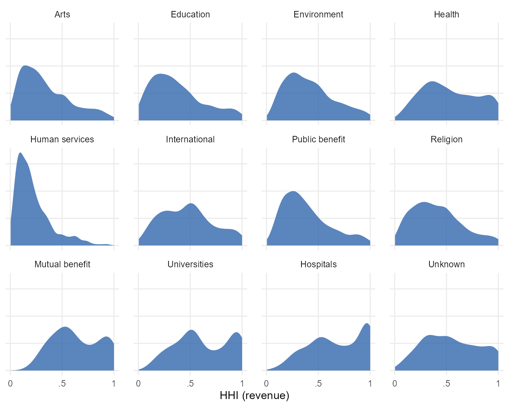
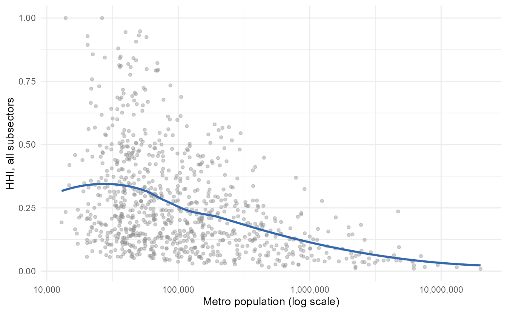
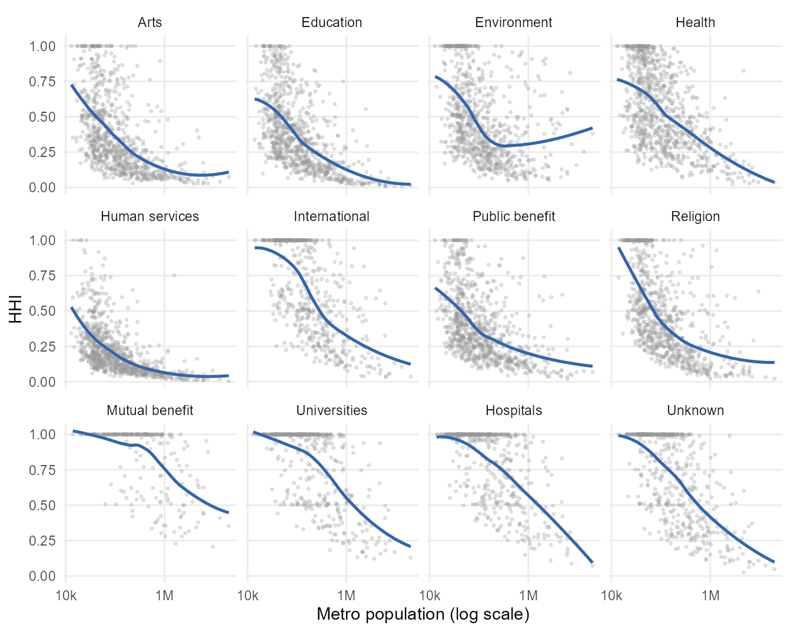
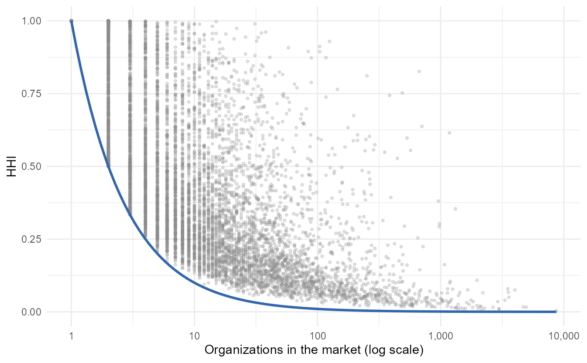
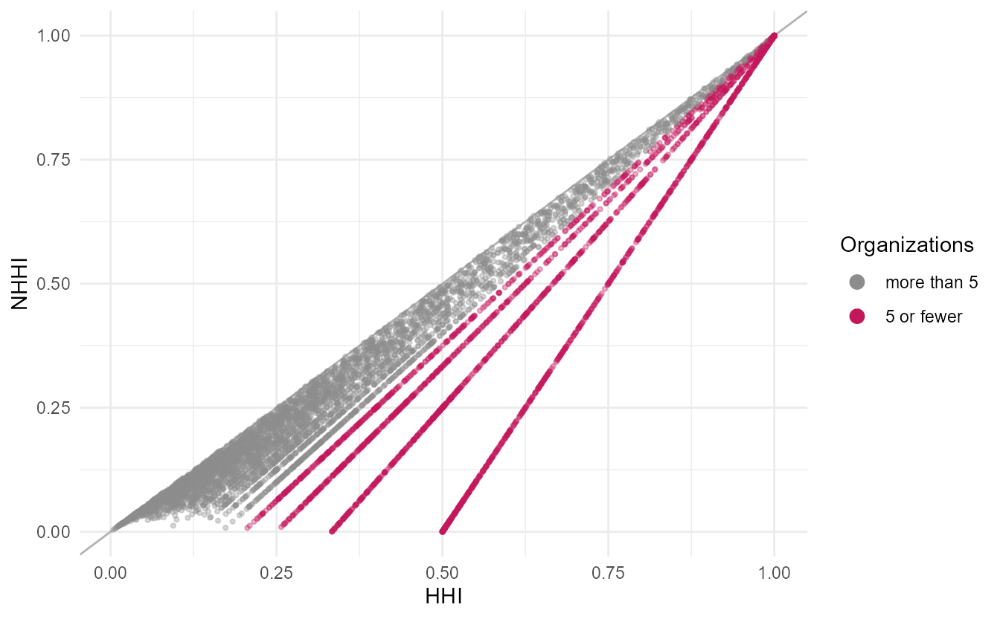

# Herfindahl-Hirschman Index

The Herfindahl-Hirschman Index (HHI) is the standard measure of market
concentration. It is the sum of squared market shares:

``` math
HHI = \sum_{i=1}^{N} s_i^2, \qquad s_i = \frac{x_i}{\sum_j x_j}
```

where $`x_i`$ is an organization’s resource (revenue, expenses or net
assets). HHI runs from $`1/N`$, when all $`N`$ organizations are the
same size, to 1, when one organization holds everything. Squaring the
shares gives large organizations most of the weight.

Because the floor depends on $`N`$, a market of two equal organizations
scores 0.5 while a market of 50 equal organizations scores 0.02. The
normalized HHI removes that floor so every market runs from 0 to 1:

``` math
NHHI = \frac{HHI - 1/N}{1 - 1/N}
```

[`get_hhi()`](https://nonprofit-open-data-collective.github.io/npcompete/reference/get_hhi.md)
returns HHI and
[`get_nhhi()`](https://nonprofit-open-data-collective.github.io/npcompete/reference/get_nhhi.md)
returns both.

``` r

library( npcompete )
library( ggplot2 )
#> Warning: package 'ggplot2' was built under R version 4.4.3

# NTMAJ12 labels for the NTEEV2 major groups
ntmaj12 <- c( ART = "Arts",           EDU = "Education",
              ENV = "Environment",    HEL = "Health",
              HMS = "Human services", IFA = "International",
              PSB = "Public benefit", REL = "Religion",
              MMB = "Mutual benefit", UNI = "Universities",
              HOS = "Hospitals",      UNU = "Unknown" )
```

## A toy market

Three markets: four equal organizations, one dominant organization with
three small ones, and two equal organizations.

``` r

GEO    <- rep( c( "equal", "dominant", "duopoly" ), c( 4, 4, 2 ) )
TOTREV <- c( 25, 25, 25, 25,   70, 10, 10, 10,   50, 50 )

toy <- data.frame( GEO, SUB = "ART", YEAR = 2020, TOTREV )

h <- get_nhhi( toy, geography = "GEO", subsector = "SUB", year = "YEAR" )
subset( h, GEO != "ALL" & SUB != "ALL" ) |> knitr::kable( digits = 3 )
```

| GEO      | SUB | YEAR |   N | TOTREV |  HHI | NHHI |
|:---------|:----|-----:|----:|-------:|-----:|-----:|
| dominant | ART | 2020 |   4 |    100 | 0.52 | 0.36 |
| duopoly  | ART | 2020 |   2 |    100 | 0.50 | 0.00 |
| equal    | ART | 2020 |   4 |    100 | 0.25 | 0.00 |

The equal and duopoly markets are both perfectly balanced, so their NHHI
is 0, but their HHI differs because the duopoly has fewer organizations.
The dominant market has the highest HHI and a clearly positive NHHI.

## Computing HHI from org-level data

`npo_panel_sample` holds every 501(c)(3) filer in Vermont from 2015 to
2019. Each row is an organization-year. The defaults expect `NTEEV2`,
`TOTREV` and `TAXYEAR` columns; here the market is the county.

``` r

vt <- get_nhhi( npo_panel_sample, geography = "COUNTY_FIPS" )

# all subsectors combined, one row per county
vt19 <- subset( vt, YEAR == 2019 & SUB == "ALL" & GEO != "ALL" )
vt19[ order( vt19$HHI ), ] |> knitr::kable( digits = 3, row.names = FALSE )
```

| GEO   | SUB | YEAR |   N |     TOTREV |   HHI |  NHHI |
|:------|:----|-----:|----:|-----------:|------:|------:|
| 50027 | ALL | 2019 | 209 |  531664166 | 0.078 | 0.074 |
| 50025 | ALL | 2019 | 181 |  493992132 | 0.122 | 0.117 |
| 50023 | ALL | 2019 | 251 |  892948016 | 0.128 | 0.124 |
| 50013 | ALL | 2019 |  15 |    5953848 | 0.139 | 0.077 |
| 50003 | ALL | 2019 | 124 |  407276766 | 0.225 | 0.219 |
| 50009 | ALL | 2019 |   7 |     660374 | 0.227 | 0.098 |
| 50017 | ALL | 2019 |  73 |  134978038 | 0.228 | 0.217 |
| 50015 | ALL | 2019 |  83 |  164242466 | 0.237 | 0.228 |
| 50005 | ALL | 2019 |  82 |  213517887 | 0.240 | 0.230 |
| 50007 | ALL | 2019 | 414 | 3104992885 | 0.268 | 0.267 |
| 50019 | ALL | 2019 |  54 |  193858577 | 0.322 | 0.309 |
| 50011 | ALL | 2019 |  53 |  214552885 | 0.360 | 0.348 |
| 50001 | ALL | 2019 | 123 |  655600800 | 0.397 | 0.392 |
| 50021 | ALL | 2019 | 117 |  465598138 | 0.423 | 0.418 |

Rows with `SUB = "ALL"` pool every subsector in a county, and rows with
`GEO = "ALL"` pool every county in a subsector.

## HHI across US metro areas

Vermont has only 14 counties. `cbsa_metrics` holds every metric for
every US metro and micro area (CBSA) in 2019, by NTEE major group,
measured on total revenue. It was built with
[`get_all_metrics()`](https://nonprofit-open-data-collective.github.io/npcompete/reference/get_all_metrics.md).

``` r

metros <- cbsa_metrics
metros$NTMAJ12 <- factor( ntmaj12[ metros$SUB ], levels = ntmaj12 )

# subsector markets that have at least one organization
# (a few markets with zero total revenue have no HHI)
markets <- subset( metros, SUB != "ALL" & N > 0 & !is.na( HHI ) )
```

### Descriptive statistics by subsector

``` r

markets |>
  dplyr::group_by( NTMAJ12 ) |>
  dplyr::summarize(
    metros      = dplyr::n(),
    median_N    = median( N ),
    HHI_p25     = quantile( HHI, 0.25, na.rm = TRUE ),
    HHI_median  = median( HHI, na.rm = TRUE ),
    HHI_p75     = quantile( HHI, 0.75, na.rm = TRUE ),
    NHHI_median = median( NHHI, na.rm = TRUE ),
    monopoly    = mean( N == 1 )
  ) |>
  knitr::kable( digits = 2 )
```

| NTMAJ12        | metros | median_N | HHI_p25 | HHI_median | HHI_p75 | NHHI_median | monopoly |
|:---------------|-------:|---------:|--------:|-----------:|--------:|------------:|---------:|
| Arts           |    894 |        9 |    0.16 |       0.30 |    0.53 |        0.17 |     0.06 |
| Education      |    916 |       12 |    0.18 |       0.33 |    0.53 |        0.24 |     0.02 |
| Environment    |    872 |        6 |    0.25 |       0.43 |    0.70 |        0.25 |     0.12 |
| Health         |    912 |        9 |    0.33 |       0.52 |    0.80 |        0.44 |     0.05 |
| Human services |    936 |       36 |    0.10 |       0.17 |    0.29 |        0.14 |     0.01 |
| International  |    567 |        3 |    0.37 |       0.64 |    1.00 |        0.51 |     0.33 |
| Public benefit |    919 |       11 |    0.21 |       0.34 |    0.53 |        0.25 |     0.03 |
| Religion       |    865 |        6 |    0.25 |       0.43 |    0.66 |        0.24 |     0.12 |
| Mutual benefit |    259 |        1 |    0.70 |       1.00 |    1.00 |        1.00 |     0.58 |
| Universities   |    489 |        2 |    0.55 |       0.99 |    1.00 |        0.98 |     0.45 |
| Hospitals      |    538 |        2 |    0.57 |       0.96 |    1.00 |        0.94 |     0.36 |
| Unknown        |    555 |        2 |    0.45 |       0.79 |    1.00 |        0.68 |     0.35 |

`monopoly` is the share of metros where the subsector has a single
organization, which scores HHI = NHHI = 1. Hospitals, universities and
mutual benefit organizations are thin in most metros, so their HHIs are
high almost by construction. Human services, with a median of three
dozen organizations per metro, is the least concentrated subsector.

### Distribution by subsector

Single-organization markets are left out of the density plots; they are
a spike at 1.

``` r

ggplot( subset( markets, N > 1 ), aes( HHI ) ) +
  geom_density( fill = "#3266ad", colour = NA, alpha = 0.8 ) +
  facet_wrap( ~ NTMAJ12, ncol = 4 ) +
  scale_x_continuous( breaks = c( 0, 0.5, 1 ), labels = c( "0", ".5", "1" ) ) +
  labs( x = "HHI (revenue)", y = NULL ) +
  theme_minimal() +
  theme( axis.text.y      = element_blank(),
         panel.grid.minor = element_blank(),
         panel.spacing.x  = unit( 1, "lines" ) )
```



The US antitrust guidelines describe markets with HHI below 0.15 as
unconcentrated, 0.15 to 0.25 as moderately concentrated and above 0.25
as highly concentrated (on the 0-10,000 scale: 1,500 and 2,500). By that
yardstick most nonprofit subsector markets are highly concentrated:

``` r

cuts       <- c( 0, 0.15, 0.25, 1 )
band_names <- c( "unconcentrated", "moderate", "high" )

markets$HHI_BAND <- cut( markets$HHI, cuts, band_names, include.lowest = TRUE )

prop.table( table( markets$NTMAJ12, markets$HHI_BAND ), margin = 1 ) |>
  round( 2 ) |>
  knitr::kable()
```

|                | unconcentrated | moderate | high |
|:---------------|---------------:|---------:|-----:|
| Arts           |           0.23 |     0.18 | 0.59 |
| Education      |           0.19 |     0.17 | 0.64 |
| Environment    |           0.10 |     0.14 | 0.76 |
| Health         |           0.05 |     0.10 | 0.85 |
| Human services |           0.42 |     0.26 | 0.32 |
| International  |           0.06 |     0.08 | 0.85 |
| Public benefit |           0.13 |     0.19 | 0.68 |
| Religion       |           0.13 |     0.14 | 0.74 |
| Mutual benefit |           0.00 |     0.01 | 0.99 |
| Universities   |           0.01 |     0.04 | 0.95 |
| Hospitals      |           0.01 |     0.02 | 0.97 |
| Unknown        |           0.03 |     0.05 | 0.92 |

### HHI and metro size

Larger metros have more organizations, so concentration falls with
population. The line is a loess smooth across metros, all subsectors
combined.

``` r

all_subs <- subset( metros, SUB == "ALL" & !is.na( POP ) )

ggplot( all_subs, aes( POP, HHI ) ) +
  geom_point( colour = "grey55", alpha = 0.4, size = 1.2 ) +
  geom_smooth( method = "loess", formula = y ~ x, se = FALSE,
               colour = "#3266ad", linewidth = 1 ) +
  scale_x_log10( labels = scales::label_comma() ) +
  labs( x = "Metro population (log scale)", y = "HHI, all subsectors" ) +
  theme_minimal()
```



By subsector:

``` r

ggplot( subset( markets, !is.na( POP ) ), aes( POP, HHI ) ) +
  geom_point( colour = "grey60", alpha = 0.25, size = 0.6 ) +
  geom_smooth( method = "loess", formula = y ~ x, se = FALSE,
               colour = "#3266ad", linewidth = 0.9 ) +
  facet_wrap( ~ NTMAJ12, ncol = 4 ) +
  scale_x_log10( breaks = c( 1e4, 1e6 ), labels = c( "10k", "1M" ) ) +
  labs( x = "Metro population (log scale)", y = "HHI" ) +
  theme_minimal() +
  theme( panel.grid.minor = element_blank() )
```



### HHI versus NHHI

HHI cannot fall below $`1/N`$ (the curve). Small markets sit high on the
chart partly because of that floor, which is the reason for the
normalized index.

``` r

ggplot( markets, aes( N, HHI ) ) +
  geom_point( colour = "grey55", alpha = 0.25, size = 0.8 ) +
  geom_function( fun = function( x ) 1 / x, colour = "#3266ad",
                 linewidth = 1 ) +
  scale_x_log10( labels = scales::label_comma() ) +
  labs( x = "Organizations in the market (log scale)", y = "HHI" ) +
  theme_minimal()
```



In large markets $`1/N`$ is close to zero and the two indices agree.
They diverge only in markets with a handful of organizations:

``` r

ggplot( subset( markets, N > 1 ), aes( HHI, NHHI ) ) +
  geom_abline( colour = "grey70" ) +
  geom_point( aes( colour = N <= 5 ), alpha = 0.35, size = 0.8 ) +
  scale_colour_manual( values = c( "TRUE" = "#c2185b", "FALSE" = "grey55" ),
                       labels = c( "TRUE" = "5 or fewer", "FALSE" = "more than 5" ),
                       name = "Organizations" ) +
  guides( colour = guide_legend( override.aes = list( size = 3, alpha = 1 ) ) ) +
  labs( x = "HHI", y = "NHHI" ) +
  theme_minimal()
```



## Notes

- HHI depends on how the market is defined. A metro-level subsector is a
  rough stand-in for the set of organizations that actually compete for
  the same donors, clients or grants.
- Single-organization markets score 1 on both indices. Filter on `N` to
  study competition among markets that have some.
- HHI on revenue, expenses and net assets can differ a lot; pass a
  different `resource` to compare them.
