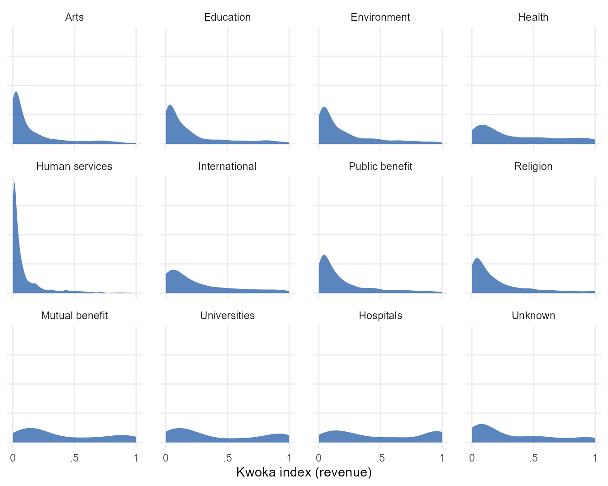
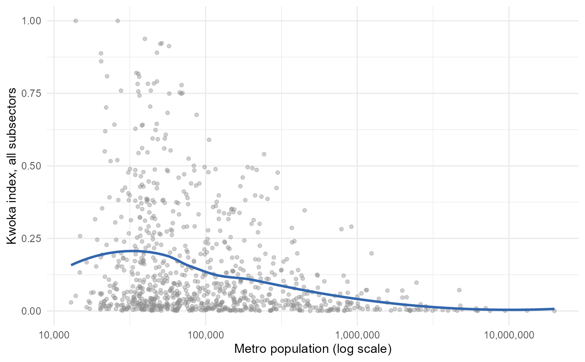
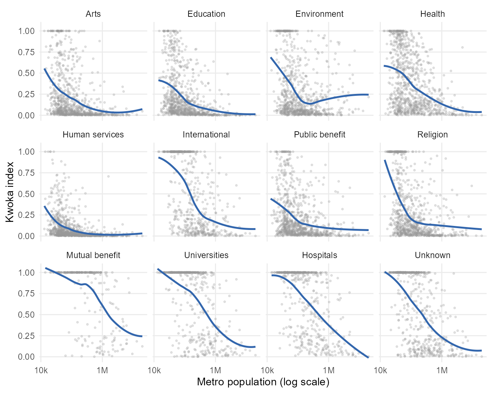
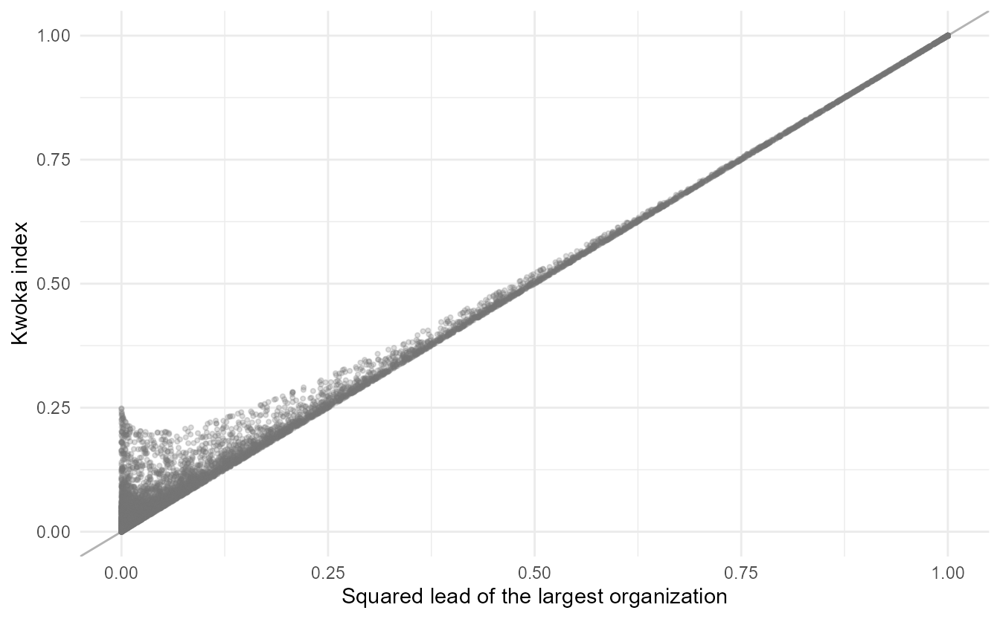
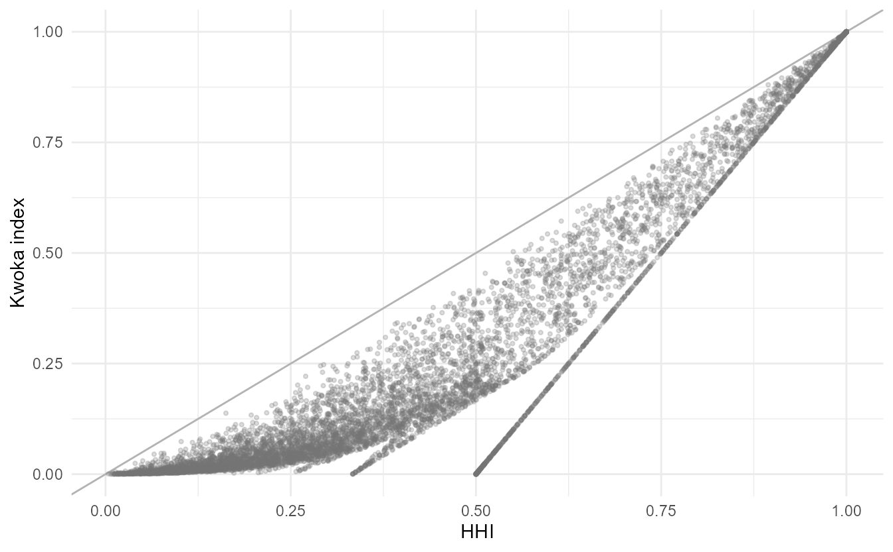

# Kwoka dominance index

Kwoka’s (1977) dominance index asks a different question from HHI: not
how concentrated a market is, but whether its leaders stand apart from
the organizations just behind them. With shares sorted from largest to
smallest,

``` math
KWOKA = \sum_{i=1}^{N-1} \left( s_{(i)} - s_{(i+1)} \right)^2
```

It is the sum of squared gaps between successive shares. The index is 0
when every organization has the same share, however few there are, and
approaches 1 when one organization holds nearly everything. A
single-organization market gets 1.

[`get_kwoka()`](https://nonprofit-open-data-collective.github.io/npcompete/reference/get_kwoka.md)
returns the index along with the shares of the three largest
organizations (`top1` to `top3`).

``` r
library( npcompete )
library( ggplot2 )

# NTMAJ12 labels for the NTEEV2 major groups
ntmaj12 <- c( ART = "Arts",           EDU = "Education",
              ENV = "Environment",    HEL = "Health",
              HMS = "Human services", IFA = "International",
              PSB = "Public benefit", REL = "Religion",
              MMB = "Mutual benefit", UNI = "Universities",
              HOS = "Hospitals",      UNU = "Unknown" )
```

## A toy market

Two markets with nearly the same HHI: a duopoly of equals, and one
leader with three small followers.

``` r
GEO    <- rep( c( "duopoly", "leader" ), c( 2, 4 ) )
TOTREV <- c( 50, 50,   70, 10, 10, 10 )

toy <- data.frame( GEO, SUB = "ART", YEAR = 2020, TOTREV )

k <- get_kwoka( toy, geography = "GEO", subsector = "SUB", year = "YEAR" )
h <- get_hhi(   toy, geography = "GEO", subsector = "SUB", year = "YEAR" )

kh <- merge( k, h[ c( "GEO", "SUB", "HHI" ) ], by = c( "GEO", "SUB" ) )
subset( kh, GEO != "ALL" & SUB != "ALL" ) |> knitr::kable( digits = 2 )
```

|     | GEO     | SUB | YEAR |   N | top1 | top2 | top3 | KWOKA |  HHI |
|:----|:--------|:----|-----:|----:|-----:|-----:|-----:|------:|-----:|
| 4   | duopoly | ART | 2020 |   2 |  0.5 |  0.5 |   NA |  0.00 | 0.50 |
| 6   | leader  | ART | 2020 |   4 |  0.7 |  0.1 |  0.1 |  0.36 | 0.52 |

HHI rates the two markets about the same. The Kwoka index separates
them: there is no gap at all between the duopolists, and a large gap
between the leader and everyone else.

## Computing the Kwoka index from org-level data

`npo_panel_sample` holds every 501(c)(3) filer in Vermont from 2015 to
2019, one row per organization-year. Here the market is the county.

``` r
vt <- get_kwoka( npo_panel_sample, geography = "COUNTY_FIPS" )

# all subsectors combined, one row per county
vt19 <- subset( vt, YEAR == 2019 & SUB == "ALL" & GEO != "ALL" )
vt19[ order( vt19$KWOKA ), ] |> knitr::kable( digits = 3, row.names = FALSE )
```

| GEO   | SUB | YEAR |   N |  top1 |  top2 |  top3 | KWOKA |
|:------|:----|-----:|----:|------:|------:|------:|------:|
| 50027 | ALL | 2019 | 209 | 0.191 | 0.108 | 0.091 | 0.009 |
| 50013 | ALL | 2019 |  15 | 0.222 | 0.180 | 0.152 | 0.009 |
| 50025 | ALL | 2019 | 181 | 0.217 | 0.203 | 0.149 | 0.010 |
| 50023 | ALL | 2019 | 251 | 0.266 | 0.199 | 0.090 | 0.018 |
| 50009 | ALL | 2019 |   7 | 0.357 | 0.204 | 0.198 | 0.040 |
| 50003 | ALL | 2019 | 124 | 0.428 | 0.181 | 0.051 | 0.079 |
| 50005 | ALL | 2019 |  82 | 0.437 | 0.157 | 0.132 | 0.085 |
| 50017 | ALL | 2019 |  73 | 0.437 | 0.104 | 0.099 | 0.113 |
| 50019 | ALL | 2019 |  54 | 0.518 | 0.216 | 0.052 | 0.119 |
| 50015 | ALL | 2019 |  83 | 0.453 | 0.111 | 0.097 | 0.119 |
| 50011 | ALL | 2019 |  53 | 0.547 | 0.223 | 0.077 | 0.129 |
| 50007 | ALL | 2019 | 414 | 0.503 | 0.091 | 0.040 | 0.173 |
| 50001 | ALL | 2019 | 123 | 0.611 | 0.139 | 0.048 | 0.231 |
| 50021 | ALL | 2019 | 117 | 0.638 | 0.089 | 0.068 | 0.303 |

## The Kwoka index across US metro areas

`cbsa_metrics` holds every metric for every US metro and micro area
(CBSA) in 2019, by NTEE major group, measured on total revenue.

``` r
metros <- cbsa_metrics
metros$NTMAJ12 <- factor( ntmaj12[ metros$SUB ], levels = ntmaj12 )

# subsector markets with at least one organization and some revenue
markets <- subset( metros, SUB != "ALL" & N > 0 & !is.na( KWOKA ) )
```

### Descriptive statistics by subsector

``` r
markets |>
  dplyr::group_by( NTMAJ12 ) |>
  dplyr::summarize(
    metros       = dplyr::n(),
    median_N     = median( N ),
    KWOKA_p25    = quantile( KWOKA, 0.25 ),
    KWOKA_median = median( KWOKA ),
    KWOKA_p75    = quantile( KWOKA, 0.75 ),
    above_0.5    = mean( KWOKA > 0.5 )
  ) |>
  knitr::kable( digits = 2 )
```

| NTMAJ12        | metros | median_N | KWOKA_p25 | KWOKA_median | KWOKA_p75 | above_0.5 |
|:---------------|-------:|---------:|----------:|-------------:|----------:|----------:|
| Arts           |    894 |        9 |      0.02 |         0.07 |      0.29 |      0.17 |
| Education      |    916 |       12 |      0.03 |         0.10 |      0.31 |      0.17 |
| Environment    |    872 |        6 |      0.04 |         0.15 |      0.50 |      0.25 |
| Health         |    912 |        9 |      0.09 |         0.28 |      0.68 |      0.36 |
| Human services |    936 |       36 |      0.01 |         0.04 |      0.10 |      0.05 |
| International  |    567 |        3 |      0.09 |         0.42 |      1.00 |      0.47 |
| Public benefit |    919 |       11 |      0.04 |         0.11 |      0.30 |      0.15 |
| Religion       |    865 |        6 |      0.04 |         0.14 |      0.48 |      0.24 |
| Mutual benefit |    259 |        1 |      0.42 |         1.00 |      1.00 |      0.74 |
| Universities   |    489 |        2 |      0.23 |         0.98 |      1.00 |      0.67 |
| Hospitals      |    538 |        2 |      0.27 |         0.93 |      1.00 |      0.67 |
| Unknown        |    555 |        2 |      0.13 |         0.61 |      1.00 |      0.56 |

`above_0.5` is the share of metros where the index exceeds 0.5, which
roughly means the leader holds more than 70% of the market.

### Distribution by subsector

The Kwoka index is strongly right-skewed: most markets have small gaps
between successive organizations. Single-organization markets (a spike
at 1) are left out.

``` r
ggplot( subset( markets, N > 1 ), aes( KWOKA ) ) +
  geom_density( fill = "#3266ad", colour = NA, alpha = 0.8 ) +
  facet_wrap( ~ NTMAJ12, ncol = 4 ) +
  scale_x_continuous( breaks = c( 0, 0.5, 1 ), labels = c( "0", ".5", "1" ) ) +
  labs( x = "Kwoka index (revenue)", y = NULL ) +
  theme_minimal() +
  theme( axis.text.y      = element_blank(),
         panel.grid.minor = element_blank(),
         panel.spacing.x  = unit( 1, "lines" ) )
```



### The Kwoka index and metro size

All subsectors combined, one point per metro, with a loess smooth:

``` r
all_subs <- subset( metros, SUB == "ALL" & !is.na( POP ) )

ggplot( all_subs, aes( POP, KWOKA ) ) +
  geom_point( colour = "grey55", alpha = 0.4, size = 1.2 ) +
  geom_smooth( method = "loess", formula = y ~ x, se = FALSE,
               colour = "#3266ad", linewidth = 1 ) +
  scale_x_log10( labels = scales::label_comma() ) +
  labs( x = "Metro population (log scale)", y = "Kwoka index, all subsectors" ) +
  theme_minimal()
```



By subsector:

``` r
ggplot( subset( markets, !is.na( POP ) ), aes( POP, KWOKA ) ) +
  geom_point( colour = "grey60", alpha = 0.25, size = 0.6 ) +
  geom_smooth( method = "loess", formula = y ~ x, se = FALSE,
               colour = "#3266ad", linewidth = 0.9 ) +
  facet_wrap( ~ NTMAJ12, ncol = 4 ) +
  scale_x_log10( breaks = c( 1e4, 1e6 ), labels = c( "10k", "1M" ) ) +
  labs( x = "Metro population (log scale)", y = "Kwoka index" ) +
  theme_minimal() +
  theme( panel.grid.minor = element_blank() )
```



### What drives the index

In most markets the first gap, between the largest and second-largest
organization, dominates the sum. The leader’s lead can be read off the
concentration ratios: $`s_{(1)} - s_{(2)} = 2\,CR1 - CR2`$.

``` r
markets$LEAD <- 2 * markets$CR1 - markets$CR2

ggplot( subset( markets, N > 1 ), aes( LEAD^2, KWOKA ) ) +
  geom_abline( colour = "grey70" ) +
  geom_point( colour = "grey45", alpha = 0.25, size = 0.8 ) +
  labs( x = "Squared lead of the largest organization",
        y = "Kwoka index" ) +
  theme_minimal()
```



Points on the diagonal are markets where the leader’s gap is the whole
index; points above it have further large gaps lower down.

Against HHI, the Kwoka index sits below it and fans out: markets with
the same HHI can have very different dominance.

``` r
ggplot( subset( markets, N > 1 ), aes( HHI, KWOKA ) ) +
  geom_abline( colour = "grey70" ) +
  geom_point( colour = "grey45", alpha = 0.25, size = 0.8 ) +
  labs( x = "HHI", y = "Kwoka index" ) +
  theme_minimal()
```



## Notes

- The index ignores the level of concentration. Two equal organizations
  (HHI = 0.5) and 100 equal organizations (HHI = 0.01) both score 0.
  Read it next to HHI or a concentration ratio.
- Kwoka, J. E. (1977). Large firm dominance and price-cost margins in
  manufacturing industries. *Southern Economic Journal*, 44(1), 183-189.
