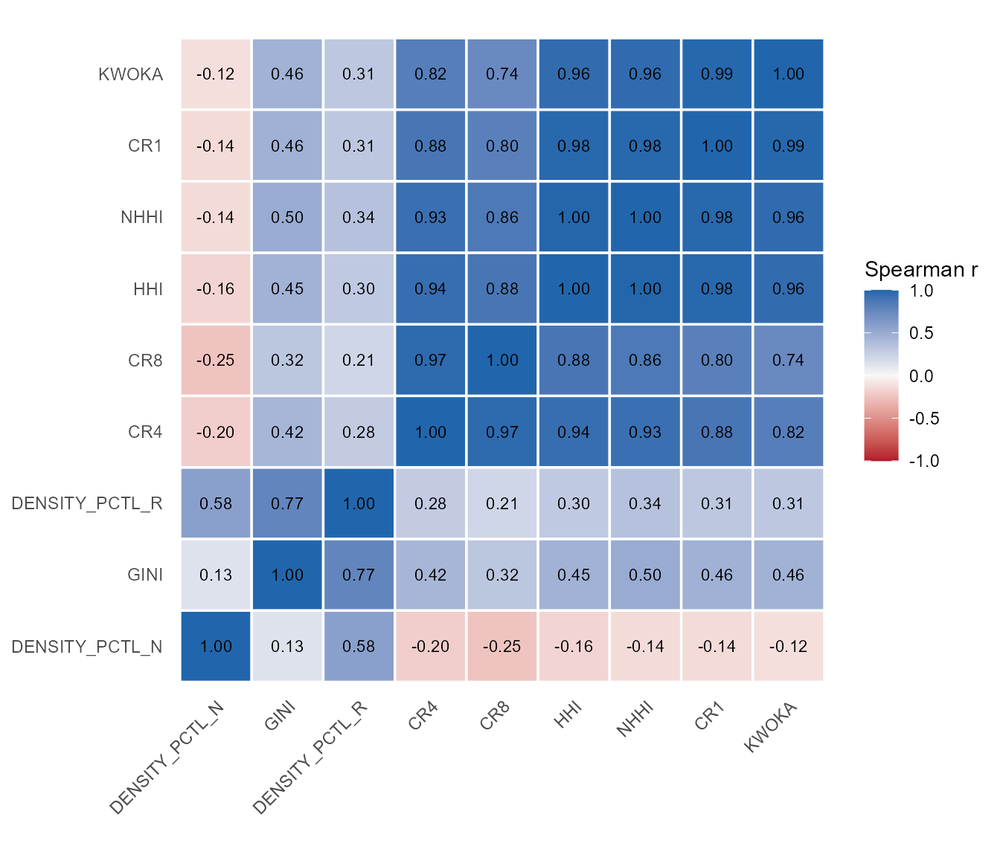
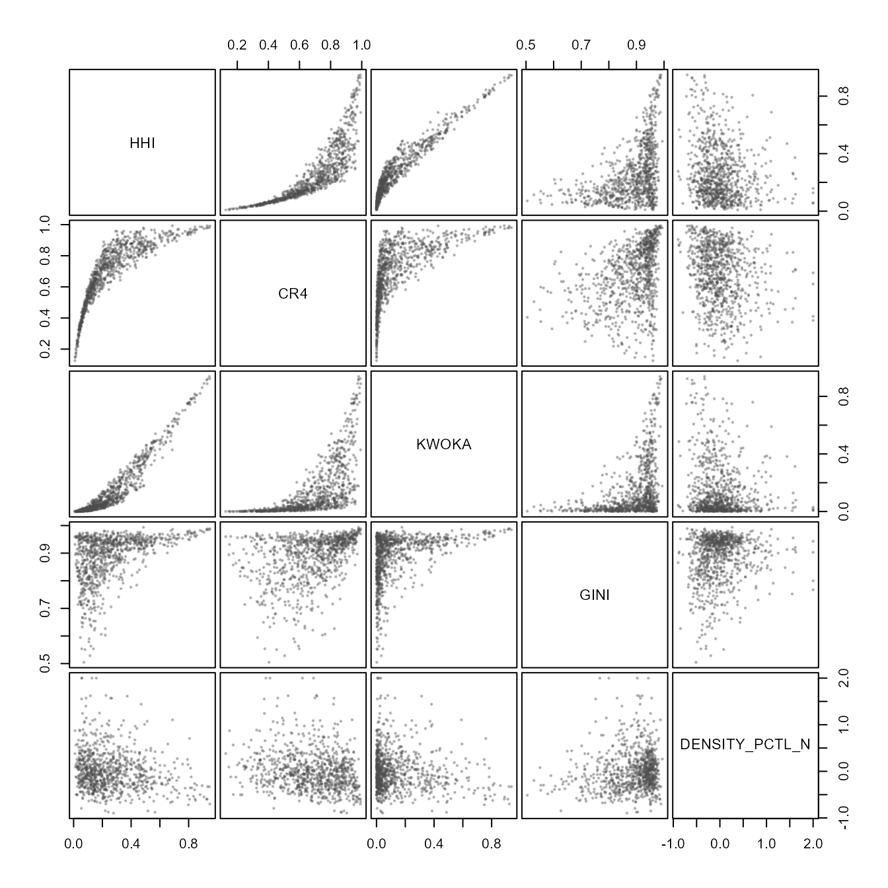
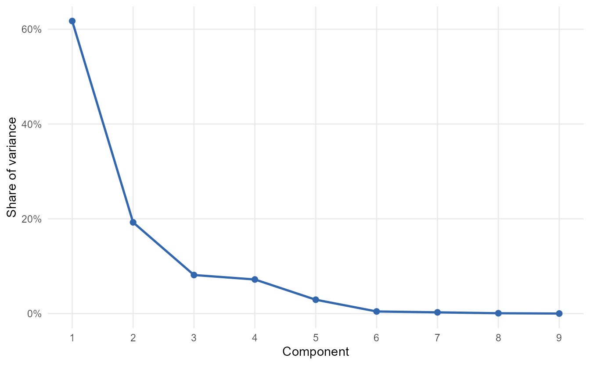
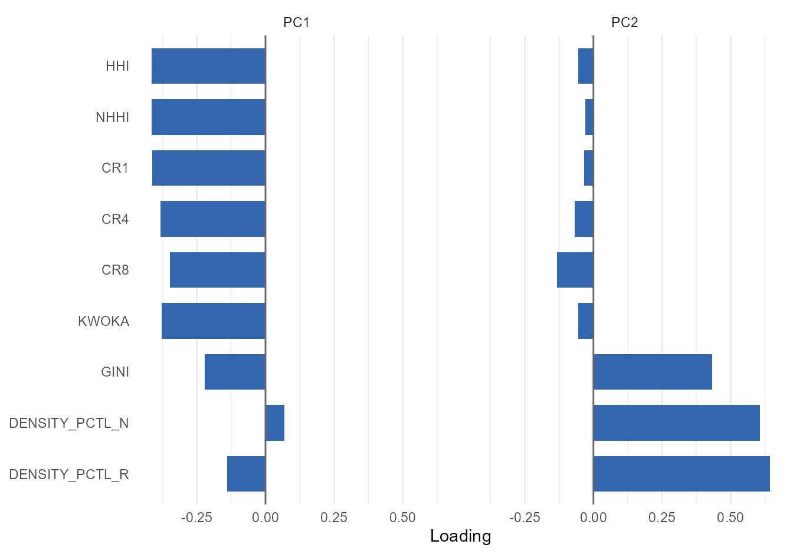
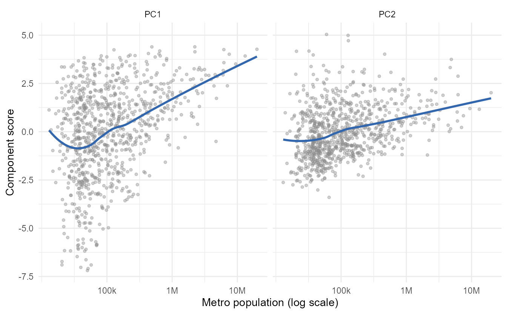

# How the metrics relate: correlation, PCA and factor analysis

npcompete computes a dozen measures of market structure. Several of them
are close variants of each other, so a natural question is how many
distinct things they measure. This page looks at the correlations among
the metrics across US metro areas and then reduces them with principal
components and factor analysis.

``` r
library( npcompete )
library( ggplot2 )

# NTMAJ12 labels for the NTEEV2 major groups
ntmaj12 <- c( ART = "Arts",           EDU = "Education",
              ENV = "Environment",    HEL = "Health",
              HMS = "Human services", IFA = "International",
              PSB = "Public benefit", REL = "Religion",
              MMB = "Mutual benefit", UNI = "Universities",
              HOS = "Hospitals",      UNU = "Unknown" )
```

## Data

`cbsa_metrics` holds every metric for every US metro and micro area
(CBSA) in 2019, by NTEE major group, measured on total revenue. Start
with the all-subsector rows, one per metro. Markets with very few
organizations are dropped because their metrics are pinned at the bounds
(CRk = 1 when $`N \le k`$, every index = 1 for a monopoly), which would
build correlation in mechanically.

``` r
metrics <- c( "HHI", "NHHI", "CR1", "CR4", "CR8", "KWOKA", "GINI",
              "DENSITY_PCTL_N", "DENSITY_PCTL_R" )

metros <- subset( cbsa_metrics, SUB == "ALL" & N >= 10 & !is.na( POP ) )
metros <- metros[ complete.cases( metros[ metrics ] ), ]

X <- metros[ metrics ]
nrow( X )
#> [1] 873
```

## Correlations

Spearman (rank) correlations, which are not driven by the long tails of
the concentration measures:

``` r
r <- cor( X, method = "spearman" )
round( r, 2 ) |> knitr::kable()
```

|  | HHI | NHHI | CR1 | CR4 | CR8 | KWOKA | GINI | DENSITY_PCTL_N | DENSITY_PCTL_R |
|:---|---:|---:|---:|---:|---:|---:|---:|---:|---:|
| HHI | 1.00 | 1.00 | 0.98 | 0.94 | 0.88 | 0.96 | 0.45 | -0.16 | 0.30 |
| NHHI | 1.00 | 1.00 | 0.98 | 0.93 | 0.86 | 0.96 | 0.50 | -0.14 | 0.34 |
| CR1 | 0.98 | 0.98 | 1.00 | 0.88 | 0.80 | 0.99 | 0.46 | -0.14 | 0.31 |
| CR4 | 0.94 | 0.93 | 0.88 | 1.00 | 0.97 | 0.82 | 0.42 | -0.20 | 0.28 |
| CR8 | 0.88 | 0.86 | 0.80 | 0.97 | 1.00 | 0.74 | 0.32 | -0.25 | 0.21 |
| KWOKA | 0.96 | 0.96 | 0.99 | 0.82 | 0.74 | 1.00 | 0.46 | -0.12 | 0.31 |
| GINI | 0.45 | 0.50 | 0.46 | 0.42 | 0.32 | 0.46 | 1.00 | 0.13 | 0.77 |
| DENSITY_PCTL_N | -0.16 | -0.14 | -0.14 | -0.20 | -0.25 | -0.12 | 0.13 | 1.00 | 0.58 |
| DENSITY_PCTL_R | 0.30 | 0.34 | 0.31 | 0.28 | 0.21 | 0.31 | 0.77 | 0.58 | 1.00 |

As a heat map, with variables ordered by hierarchical clustering:

``` r
ord <- hclust( as.dist( 1 - abs( r ) ) )$order

r_long <- as.data.frame( as.table( r[ ord, ord ] ) )
names( r_long ) <- c( "x", "y", "r" )

ggplot( r_long, aes( x, y, fill = r ) ) +
  geom_tile( colour = "white", linewidth = 0.6 ) +
  geom_text( aes( label = sprintf( "%.2f", r ) ), size = 3 ) +
  scale_fill_gradient2( low = "#b2182b", mid = "grey97", high = "#2166ac",
                        limits = c( -1, 1 ), name = "Spearman r" ) +
  coord_equal() +
  labs( x = NULL, y = NULL ) +
  theme_minimal() +
  theme( axis.text.x = element_text( angle = 45, hjust = 1 ),
         panel.grid  = element_blank() )
```



Three groups stand out:

- **Concentration**: HHI, NHHI, CR1 and the Kwoka index move almost in
  lockstep. In markets of ten or more organizations HHI and NHHI are
  nearly the same number, and the leader’s share drives all of them.
- **Breadth of the top tier**: CR4 and CR8 correlate highly with each
  other and somewhat less with CR1 and the Kwoka index, since they also
  count the organizations behind the leader.
- **Inequality and density**: the Gini correlates only moderately with
  concentration and is tied more closely to revenue density. Count
  density is nearly unrelated to concentration.

A few of the pairs plotted:

``` r
pairs( X[ c( "HHI", "CR4", "KWOKA", "GINI", "DENSITY_PCTL_N" ) ],
       pch = 19, cex = 0.3, col = grDevices::adjustcolor( "grey30", 0.3 ),
       gap = 0.3 )
```



## Principal components

PCA on the standardized metrics. Each component is a weighted
combination of the metrics, chosen to capture as much of the remaining
variance as possible.

``` r
pca <- prcomp( X, scale. = TRUE )

var_share <- pca$sdev^2 / sum( pca$sdev^2 )

data.frame( component  = paste0( "PC", seq_along( var_share ) ),
            eigenvalue = pca$sdev^2,
            share      = var_share,
            cumulative = cumsum( var_share ) ) |>
  knitr::kable( digits = 3 )
```

| component | eigenvalue | share | cumulative |
|:----------|-----------:|------:|-----------:|
| PC1       |      5.557 | 0.617 |      0.617 |
| PC2       |      1.733 | 0.193 |      0.810 |
| PC3       |      0.732 | 0.081 |      0.891 |
| PC4       |      0.647 | 0.072 |      0.963 |
| PC5       |      0.263 | 0.029 |      0.992 |
| PC6       |      0.040 | 0.004 |      0.997 |
| PC7       |      0.023 | 0.003 |      0.999 |
| PC8       |      0.006 | 0.001 |      1.000 |
| PC9       |      0.000 | 0.000 |      1.000 |

The first component carries more than half of the variance. By the
eigenvalue-above-one rule, two components are worth keeping; together
they hold about 80% of the variance.

``` r
scree <- data.frame( k = seq_along( var_share ), share = var_share )

ggplot( scree, aes( k, share ) ) +
  geom_line( colour = "#3266ad", linewidth = 0.9 ) +
  geom_point( colour = "#3266ad", size = 2 ) +
  scale_x_continuous( breaks = scree$k ) +
  scale_y_continuous( labels = scales::label_percent() ) +
  labs( x = "Component", y = "Share of variance" ) +
  theme_minimal() +
  theme( panel.grid.minor = element_blank() )
```



Loadings on the first three components:

``` r
round( pca$rotation[ , 1:3 ], 2 ) |> knitr::kable()
```

|                |   PC1 |   PC2 |   PC3 |
|:---------------|------:|------:|------:|
| HHI            | -0.41 | -0.06 | -0.16 |
| NHHI           | -0.41 | -0.03 | -0.19 |
| CR1            | -0.41 | -0.03 | -0.08 |
| CR4            | -0.38 | -0.07 |  0.46 |
| CR8            | -0.35 | -0.13 |  0.62 |
| KWOKA          | -0.38 | -0.06 | -0.43 |
| GINI           | -0.22 |  0.43 | -0.31 |
| DENSITY_PCTL_N |  0.07 |  0.61 |  0.13 |
| DENSITY_PCTL_R | -0.14 |  0.64 |  0.20 |

Plotted, the same three groups appear as in the heat map. The
concentration measures all load on PC1 (with a negative sign, so a
higher PC1 score means a less concentrated market); the Gini and the two
density indices carry PC2.

``` r
L <- data.frame( metric = rownames( pca$rotation ), pca$rotation[ , 1:2 ] )
L <- tidyr::pivot_longer( L, c( PC1, PC2 ), names_to = "component",
                          values_to = "loading" )
L$metric <- factor( L$metric, levels = rev( rownames( pca$rotation ) ) )

ggplot( L, aes( loading, metric ) ) +
  geom_col( fill = "#3266ad", width = 0.7 ) +
  geom_vline( xintercept = 0, colour = "grey40" ) +
  facet_wrap( ~ component ) +
  labs( x = "Loading", y = NULL ) +
  theme_minimal() +
  theme( panel.grid.major.y = element_blank() )
```



### Components and metro size

Metro scores on the first two components, against population. The sign
of a component is arbitrary; read it from the loadings.

``` r
scores <- data.frame( POP = metros$POP, pca$x[ , 1:2 ] )
scores <- tidyr::pivot_longer( scores, c( PC1, PC2 ),
                               names_to = "component", values_to = "score" )

ggplot( scores, aes( POP, score ) ) +
  geom_point( colour = "grey55", alpha = 0.4, size = 1 ) +
  geom_smooth( method = "loess", formula = y ~ x, se = FALSE,
               colour = "#3266ad", linewidth = 1 ) +
  facet_wrap( ~ component ) +
  scale_x_log10( breaks = c( 1e5, 1e6, 1e7 ), labels = c( "100k", "1M", "10M" ) ) +
  labs( x = "Metro population (log scale)", y = "Component score" ) +
  theme_minimal()
```



PC1 rises steeply with population: larger metros are less concentrated.
PC2 rises more gently, mostly through the Gini, which grows with metro
size (see the Gini vignette).

## Factor analysis

Factor analysis models the metrics as noisy indicators of a few latent
traits. Near-duplicate indicators make the fit unstable, so NHHI (nearly
identical to HHI here) and CR1 (nearly identical to the Kwoka index) are
left out. The concentration measures are strongly skewed, so the model
is fit to the Spearman correlation matrix rather than the raw data.

``` r
fa_vars <- c( "HHI", "CR4", "CR8", "KWOKA", "GINI",
              "DENSITY_PCTL_N", "DENSITY_PCTL_R" )

r_fa <- cor( X[ fa_vars ], method = "spearman" )

fa2 <- factanal( covmat = r_fa, factors = 2, n.obs = nrow( X ),
                 rotation = "varimax" )
```

Loadings (blank below 0.3) and uniqueness, the share of each metric’s
variance that the factors do not explain:

``` r
loading_table <- function( fa ) {
  ld <- unclass( fa$loadings )
  ld[ abs( ld ) < 0.3 ] <- NA
  data.frame( ld, uniqueness = fa$uniquenesses )
}

loading_table( fa2 ) |> knitr::kable( digits = 2 )
```

|                | Factor1 | Factor2 | uniqueness |
|:---------------|--------:|--------:|-----------:|
| HHI            |    0.94 |      NA |       0.11 |
| CR4            |    0.99 |      NA |       0.00 |
| CR8            |    0.97 |      NA |       0.05 |
| KWOKA          |    0.82 |      NA |       0.31 |
| GINI           |    0.37 |    0.71 |       0.36 |
| DENSITY_PCTL_N |      NA |    0.64 |       0.53 |
| DENSITY_PCTL_R |      NA |    0.97 |       0.00 |

The first factor is concentration: HHI, CR4, CR8 and the Kwoka index all
load on it heavily. The second is carried by the two density indices and
the Gini, a “depth of the sector” trait: metros with more nonprofit
revenue than expected for their size also have more unequal revenue
distributions. Count density has the highest uniqueness; it carries
information the other metrics do not.

A third factor splits concentration in two, the same split the heat map
showed: dominance by the leader (HHI, Kwoka) versus the weight of the
top tier as a whole (CR4, CR8).

``` r
fa3 <- factanal( covmat = r_fa, factors = 3, n.obs = nrow( X ),
                 rotation = "varimax" )

loading_table( fa3 ) |> knitr::kable( digits = 2 )
```

|                | Factor1 | Factor2 | Factor3 | uniqueness |
|:---------------|--------:|--------:|--------:|-----------:|
| HHI            |    0.78 |      NA |    0.61 |       0.00 |
| CR4            |    0.94 |      NA |    0.33 |       0.00 |
| CR8            |    0.96 |      NA |      NA |       0.04 |
| KWOKA          |    0.59 |      NA |    0.79 |       0.02 |
| GINI           |    0.30 |    0.71 |      NA |       0.35 |
| DENSITY_PCTL_N |      NA |    0.64 |      NA |       0.53 |
| DENSITY_PCTL_R |      NA |    0.98 |      NA |       0.00 |

With close to 900 metros the chi-square test of exact fit rejects both
models, as it does for almost any model on a sample this large; the
loadings are the useful part.

## Do the patterns hold within subsectors?

The same correlations inside each subsector, for subsector markets with
ten or more organizations:

``` r
subs <- subset( cbsa_metrics, SUB != "ALL" & N >= 10 )
subs$NTMAJ12 <- factor( ntmaj12[ subs$SUB ], levels = ntmaj12 )

spearman <- function( a, b ) cor( a, b, method = "spearman", use = "complete.obs" )

subs |>
  dplyr::group_by( NTMAJ12 ) |>
  dplyr::summarize(
    markets      = dplyr::n(),
    HHI_CR4      = spearman( HHI, CR4 ),
    HHI_KWOKA    = spearman( HHI, KWOKA ),
    HHI_GINI     = spearman( HHI, GINI ),
    HHI_DENSITY  = spearman( HHI, DENSITY_PCTL_N ),
    GINI_DENSITY = spearman( GINI, DENSITY_PCTL_N )
  ) |>
  knitr::kable( digits = 2 )
```

| NTMAJ12        | markets | HHI_CR4 | HHI_KWOKA | HHI_GINI | HHI_DENSITY | GINI_DENSITY |
|:---------------|--------:|--------:|----------:|---------:|------------:|-------------:|
| Arts           |     441 |    0.96 |      0.93 |     0.33 |       -0.10 |        -0.01 |
| Education      |     542 |    0.94 |      0.95 |     0.39 |       -0.07 |         0.00 |
| Environment    |     311 |    0.93 |      0.94 |     0.63 |       -0.26 |        -0.19 |
| Health         |     446 |    0.85 |      0.97 |     0.55 |        0.04 |        -0.03 |
| Human services |     839 |    0.96 |      0.93 |     0.18 |       -0.14 |         0.12 |
| International  |     133 |    0.95 |      0.96 |     0.65 |        0.06 |         0.01 |
| Public benefit |     512 |    0.91 |      0.94 |     0.36 |       -0.04 |        -0.02 |
| Religion       |     296 |    0.94 |      0.95 |     0.57 |       -0.07 |        -0.07 |
| Mutual benefit |      12 |    0.92 |      0.92 |     0.52 |       -0.27 |        -0.21 |
| Universities   |      64 |    0.87 |      0.94 |     0.74 |        0.03 |         0.00 |
| Hospitals      |      57 |    0.83 |      0.97 |     0.55 |       -0.24 |        -0.40 |
| Unknown        |      90 |    0.93 |      0.96 |     0.70 |       -0.07 |        -0.18 |

The concentration measures agree just as closely inside every subsector.
The link between concentration and inequality (`HHI_GINI`) is weaker in
the crowded subsectors, such as human services and the arts, and
stronger in thin ones. Within subsectors the Gini is unrelated to count
density; the moderate pooled correlation comes from differences between
metros as a whole. Subsectors with few metros above the ten-organization
threshold (mutual benefit, universities, hospitals) give noisy
estimates.

## Takeaways

- In markets of ten or more organizations, HHI, NHHI, CR1 and the Kwoka
  index are close substitutes; reporting more than one or two of them
  adds little.
- CR4 and CR8 add information about the breadth of the top tier.
- The Gini measures something different from concentration and sits
  closer to revenue density.
- Count density is the most independent metric and should be reported
  alongside a concentration measure rather than in place of one.
